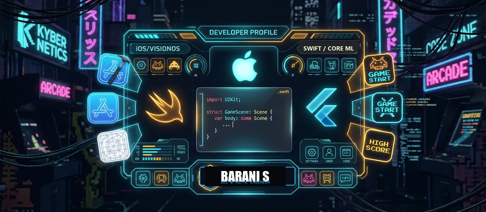
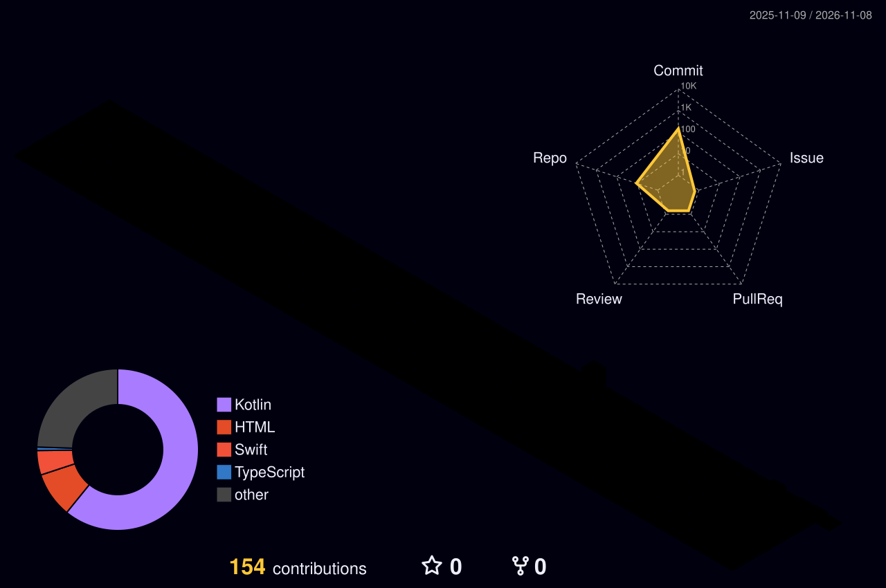

# Comprehensive Analysis & Comparative Technical Report: GitHub Profile README Repositories
**Author / Subject:** Barani S (`Barani2504-main`) vs. Kaushal Maran (`kaushalboii-main`)  
**Scope:** Architecture, Source Code, CI/CD Pipelines, Custom SVG Engines, Visual Design & Engineering Strategies  
**Generated Date:** 2026-11-14

---

## Table of Contents
1. [Executive Summary & High-Level Comparison](#1-executive-summary--high-level-comparison)
2. [Architectural Matrix & Feature-by-Feature Breakdown](#2-architectural-matrix--feature-by-feature-breakdown)
3. [Deep Dive: Barani2504-main (Your Profile)](#3-deep-dive-barani2504-main-your-profile)
   - 3.1 [Design Philosophy & Target Audience](#31-design-philosophy--target-audience)
   - 3.2 [Complete README.md Source Code](#32-complete-readmemd-source-code)
   - 3.3 [GitHub Actions Workflows](#33-github-actions-workflows)
4. [Deep Dive: kaushalboii-main](#4-deep-dive-kaushalboii-main)
   - 4.1 [Design Philosophy & Custom Vector Graphics Pipeline](#41-design-philosophy--custom-vector-graphics-pipeline)
   - 4.2 [Complete README.md Source Code](#42-complete-readmemd-source-code)
   - 4.3 [Terminal Boot Log (`kaushalboii`)](#43-terminal-boot-log-kaushalboii)
   - 4.4 [GitHub Actions Workflows](#44-github-actions-workflows)
   - 4.5 [The Complete Python Automation Suite (`scripts/`)](#45-the-complete-python-automation-suite-scripts)
5. [In-Depth Comparative Engineering Analysis](#5-in-depth-comparative-engineering-analysis)
   - 5.1 [Third-Party Microservices vs. Self-Contained Vector Compilation](#51-third-party-microservices-vs-self-contained-vector-compilation)
   - 5.2 [Credential & Production Verification vs. Aesthetic Hacker Showcasing](#52-credential--production-verification-vs-aesthetic-hacker-showcasing)
   - 5.3 [Contribution Activity Visualizations](#53-contribution-activity-visualizations)
6. [Cross-Pollination & Actionable Recommendations for Barani](#6-cross-pollination--actionable-recommendations-for-barani)

---

## 1. Executive Summary & High-Level Comparison

Both repositories represent **GitHub Profile Repositories**—special repositories named identically to the owner's GitHub username (`Barani2504/Barani2504` and `kaushalboii/kaushalboii`) whose root `README.md` is rendered natively on their public GitHub profile pages.

| Dimension | `Barani2504-main` (Your Profile) | `kaushalboii-main` |
| :--- | :--- | :--- |
| **Primary Identity** | **Native iOS & Applied AI/ML Engineer** | **Creative Mobile & Systems Engineer** |
| **Core Specialization** | iOS (Swift, SwiftUI, UIKit), Edge AI (Core ML, TFLite, YOLOv8), Healthcare Tech | iOS (SwiftUI), Android (Jetpack Compose), UI/UX Motion Systems, Python Agentic AI |
| **Design Language** | **Polished Executive Engineering Portfolio**: Corporate header banner, typing SVG headline, structured skill matrices, verifiable credentials, expandable engineering sheets. | **Cyberpunk Terminal / CLI Environment**: Simulated UNIX terminal commands (`whoami`, `systemctl status`, `./arcade.sh`), custom ASCII portrait, dark neon console cards. |
| **Data Architecture** | **Service-Driven / API Integration**: Leverages external dynamic services (Vercel GitHub Readme Stats, Streak Stats, Komarev View Counter, Profile Summary Cards). | **Self-Contained CI/CD Vector Pipeline**: Pure local Python automation scraping GitHub unauthenticated HTML, deriving metrics locally, and compiling animated SVG files natively. |
| **Credibility Signals** | Shipped TestFlight metrics (3–5 healthcare apps), 100+ mentored engineers, verifiable Microsoft Azure DP-900 certificate with high-res PDF and verification code. | Custom-engineered computer vision ASCII converter, edge-preserving image filtering, and procedural animated SVG graphic generators. |

---

## 2. Architectural Matrix & Feature-by-Feature Breakdown

| Feature | `Barani2504-main` | `kaushalboii-main` |
| :--- | :--- | :--- |
| **Hero / Header** | Full-width branded graphic banner + Demolab Typing SVG + Status Badges | CLI prompt `whoami` + side-by-side terminal table (monochrome ASCII portrait + stats) |
| **Embedded Code Snippets** | Native Swift data structure (`struct DeveloperProfile`) + Current Focus YAML | Simulated shell scripts (`./dev_system.sh`, `./building-blocks.sh`, `./arcade.sh`) + system boot file |
| **Stats & Streaks** | GitHub Readme Stats + Streak Stats + Top Languages + Profile Summary Cards | Custom `stats.svg` (SMIL animated count-ups, monthly histogram bar chart) |
| **Heatmap & Snake** | 3D Isometric Contribution Graph (`yoshi389111`) + Pacman Snake (`abozanona`) | Custom Animated Heatmap (`generate_streak_svg.py`) + Pacman Snake (`abozanona`) |
| **Technical Stack** | Categorized table (iOS, AI/ML, Backend, DevOps) with dark SkillIcons and code tags | Single-line SkillIcons bar (18 icons, 9 per row) + `building-blocks.svg` card architecture |
| **Featured Projects** | 2x2 grid of pinned repo cards + collapsible `<details>` table of system architectures | Structured tree views in `building-blocks.svg` and deployment log metrics |
| **Certifications** | Microsoft Azure DP-900 high-res certificate + PDF download link + verification badge + CP links | Emphasized via runtime telemetry logs and apps shipped count |
| **GitHub Actions** | 2 workflows (`pacman.yml`, `profile-3d-contrib.yml`) | 2 workflows (`pacman.yml`, `update-profile-art.yml` running 7 Python scripts) |

---

## 3. Deep Dive: Barani2504-main (Your Profile)

### 3.1 Design Philosophy & Target Audience
Your profile is built with an **Executive Career & Production Credibility** focus. When technical recruiters, hiring managers, and enterprise leads visit your profile, the visual and architectural hierarchy immediately answers:
1. **Who you are:** Native iOS & AI/ML Engineer with an 8.0 CGPA from SIMATS Engineering.
2. **What you build:** Production healthcare applications combining Swift/SwiftUI with on-device intelligence (Core ML, TFLite, YOLOv8).
3. **Proof of delivery:** 3–5 apps shipped to TestFlight/App Store, 100+ junior developers mentored, and an official Microsoft DP-900 certification with verification code `wBmAX-2FMV`.
4. **Engineering Depth:** An expandable architecture sheet describing offline-first caching, RAG systems, and Judge0 distributed code execution engines.

### 3.2 Complete README.md Source Code (`Barani2504-main/README.md`)

```markdown
<div align="center">

  <!-- Banner -->
  <a href="https://linkedin.com/in/barani-s-4a479930b" target="_blank">
    
  </a>

  <br/><br/>

  <!-- Typing SVG -->
  <a href="https://git.io/typing-svg">
    
  </a>

  <br/>

  <!-- Status Badges -->
  <p align="center">
    
    
    
    
  </p>

  <!-- Social Links -->
  <p align="center">
    <a href="https://linkedin.com/in/barani-s-4a479930b" target="_blank">
      
    </a>
    <a href="mailto:barani2504s@gmail.com">
      
    </a>
    <a href="https://github.com/Barani2504" target="_blank">
      
    </a>
    <a href="#" target="_blank">
      
    </a>
  </p>

  <!-- Profile Counters -->
  <p align="center">
    
    
    
  </p>

</div>


### 👨‍💻 About Me

<div align="center">
  
</div>

<br/>

```swift
struct DeveloperProfile {
    let name: String         = "Barani S"
    let role: String         = "Native iOS & AI/ML Engineer"
    let education: String    = "B.Sc. Computer Science, 2022-2026"
    let organization: String = "SIMATS Engineering"

    // Core Expertise
    let primaryFocus: String = "iOS Healthcare & AI/ML Applications"
    let aiSpecialty: String  = "On-Device Inference - Core ML & TFLite"
    let deployment: String   = "App Store Connect & TestFlight"

    // Tech Stack
    let stack: [String] = [
        "Swift", "SwiftUI", "UIKit",
        "Core ML", "Combine", "TFLite"
    ]
}
```

- 🎯 **Focus:** Engineering production-grade iOS healthcare & AI applications with on-device intelligence.
- 🛠️ **Core Skills:** Swift, SwiftUI, UIKit, Core ML, TensorFlow Lite, YOLOv8, Combine, Core Data & Clean MVVM.
- 🏆 **Key Achievement:** Shipped 3–5 production medical apps to TestFlight & mentored 100+ developers.

I build **native iOS applications** with Swift and SwiftUI — spanning the full app lifecycle from interface design and REST API integration to on-device AI/ML inference and App Store release management. My work sits at the intersection of **mobile engineering, applied AI/ML, and full-stack backend development**, with hands-on delivery of healthcare and developer-tooling products used in real deployments.

I've shipped 3–5 production healthcare apps end-to-end, built a Judge0-based multi-language code execution platform backed by RAG, and mentored 100+ engineers across iOS, Android, and web stacks during code reviews.

<table align="center" width="100%">
<tr>
<td width="50%" valign="top">

**🔭 Currently**
- iOS App Developer Intern @ SIMATS Engineering
- Shipping AI-integrated healthcare apps to TestFlight / App Store
- Developing on-device neural vision pipelines with Core ML & YOLOv8

</td>
<td width="50%" valign="top">

**🌱 Open To**
- iOS Developer / Mobile Engineer opportunities
- AI/ML-integrated mobile products
- Full-stack & cross-platform mobile collaborations

</td>
</tr>
</table>

<br/>


### 🛠️ Technical Skills

<div align="center">

| Category | Skills | Technologies |
| :--- | :--- | :--- |
| **iOS Development** | Native App Development |  `SwiftUI` `UIKit` `Combine` `Core Data` `Swift Concurrency` |
| **On-Device AI / ML** | Machine Learning & Computer Vision |  `Core ML` `TensorFlow Lite` `YOLOv8` `RAG Systems` |
| **Backend & APIs** | Server-side & API Integration |  `REST APIs` `JSON` `Judge0` |
| **Tools & Platforms** | DevOps, Android & Tooling |  `Xcode` `TestFlight` `Apple HIG` |

</div>

<br/>


### 🧠 AI / ML Expertise

<div align="center">

| Domain | Proficiency | Details |
|:--|:--:|:--|
| **On-Device Inference** | ●●●●○ | Core ML & TensorFlow Lite deployment for offline, private, real-time predictions on iOS |
| **Computer Vision** | ●●●●○ | YOLOv8-based detection pipeline for medical CT image analysis (kidney stone detection) |
| **RAG Systems** | ●●●○○ | Retrieval-Augmented Generation for code assistant & multi-language platform support |
| **AI Chatbot Development** | ●●●●○ | Conversational health-monitoring chatbot with real-time vitals context |

</div>

<br/>


### 🚀 Featured Projects

<table border="0" width="100%">
  <tr>
    <td width="50%" align="center" valign="top">
      <a href="https://github.com/Barani2504/Corecare_iOS" target="_blank">
        
      </a>
      <br/>
      <sub><b>🩺 CoreCare iOS</b> — AI-powered cardiac care & self-monitoring with offline-first persistence & real-time chatbot.</sub>
    </td>
    <td width="50%" align="center" valign="top">
      <a href="https://github.com/Barani2504/Renal-Calculi" target="_blank">
        
      </a>
      <br/>
      <sub><b>🫘 SIMATS Renal Calculi</b> — On-device CT medical imaging & kidney stone detection using Core ML & YOLOv8.</sub>
    </td>
  </tr>
  <tr>
    <td width="50%" align="center" valign="top">
      <br/>
      <a href="https://github.com/Barani2504/Codego_Compiler" target="_blank">
        
      </a>
      <br/>
      <sub><b>⚙️ Codego Multi-Language Engine</b> — Load-balanced online code execution platform paired with RAG assistant.</sub>
    </td>
    <td width="50%" align="center" valign="top">
      <br/>
      <a href="https://github.com/Barani2504/Code_in_go_android" target="_blank">
        
      </a>
      <br/>
      <sub><b>📱 Code-In-Go Android</b> — Native mobile client engineered with Kotlin & sandboxed telemetry execution.</sub>
    </td>
  </tr>
</table>

<br/>

<details>
<summary><b>🔍 View Architecture & Engineering Details</b></summary>
<br/>

| Project | Tech Stack | Architecture & Engineering Highlights |
|:--|:--|:--|
| **CoreCare iOS** | `SwiftUI`, `Core Data`, `SQLite`, `PHP`, `MySQL`, `REST APIs` | Offline-first encrypted local caching, continuous cardiac vitals tracking, and interactive AI chatbot for patient self-care. Multi-version TestFlight deployment. |
| **SIMATS Renal Calculi** | `SwiftUI`, `Core ML`, `TensorFlow Lite`, `YOLOv8` | 100% on-device neural network inference for radiology CT scans. Detects stone count, size, and anatomical coordinates without patient telemetry leaving device. |
| **Codego Platform** | `React`, `NestJS`, `Redis`, `Judge0`, `RAG` | Distributed load balancer orchestrating multi-language code executions across isolated sandboxes with Redis caching. |
| **LungCare** | `HTML5`, `CSS3`, `JavaScript`, `REST API` | Preventive respiratory telemetry portal with responsive interface and dynamic clinical metrics. |

</details>

<br/>


### 💼 Work Experience

**iOS App Developer Intern** · SIMATS Engineering  
`2025 — Present`

Full-lifecycle iOS development across a suite of production healthcare applications, from interface architecture through App Store releases, backend optimization, and cross-team mentorship.

- Developed and deployed **3–5 healthcare mobile apps** (Swift, SwiftUI) integrating REST APIs, JSON parsing, and on-device AI/ML inference following Apple HIG.
- Managed **App Store Connect & TestFlight** release pipelines across multiple build cycles — versioning, provisioning profiles, and beta distribution.
- Optimized backend **PHP/MySQL query performance** and API response latency to improve reliability across client applications.
- Provided technical guidance and conducted code reviews for **100+ engineers** across iOS, Android, and web stacks (React, Flask, Node.js, PHP).
- Independently architected a load-balancing system and a **Judge0-based multi-language coding engine** powered by RAG.

`Swift` `SwiftUI` `Core ML` `PHP` `MySQL` `REST APIs` `Git` `Technical Mentorship`

<br/>


### 📊 GitHub Statistics

<div align="center">
  <table border="0">
    <tr>
      <td align="center">
        
      </td>
      <td align="center">
        
      </td>
    </tr>
  </table>

  <br />

  
</div>

<br/>


### 🏆 Achievements & Recognition

<div align="center">


<br/><br/>

| Achievement | Details |
|:--|:--|
| 🏥 **Healthcare App Delivery** | Shipped 3–5 production healthcare apps to TestFlight & App Store Connect |
| 👨‍🏫 **Peer Mentorship** | Guided and reviewed code for 100+ student developers across iOS, Android & web stacks |
| 🧠 **AI-Integrated Platforms** | Built on-device Core ML vision pipelines & RAG-powered developer platforms |

</div>

<br/>


### 📈 Contribution Activity

<div align="center">


<br/>

<table border="0">
  <tr>
    <td align="center">
      
    </td>
    <td align="center">
      
    </td>
    <td align="center">
      
    </td>
  </tr>
</table>

<sub>Contribution overview — commit history, language distribution & peak coding hours.</sub>

</div>

<br/>

### 🧊 3D Isometric Contribution Graph

<div align="center">



<sub>Isometric 3D render of commit history — auto-updated daily via GitHub Actions.</sub>

</div>

<br/>


### 🕹️ GitHub Contribution Snake

<div align="center">
  <picture>
    <source media="(prefers-color-scheme: dark)" srcset="https://raw.githubusercontent.com/Barani2504/Barani2504/output/pacman-contribution-graph-dark.svg">
    <source media="(prefers-color-scheme: light)" srcset="https://raw.githubusercontent.com/Barani2504/Barani2504/output/pacman-contribution-graph.svg">
    
  </picture>
</div>

<br/>


### 📜 Certifications & Coding Profiles

<div align="center">

<!-- Azure DP-900 Certificate Display -->
<p align="center">
  <a href="https://raw.githubusercontent.com/Barani2504/Barani2504/main/certificates/azure-dp900.pdf" target="_blank" title="Click to view or download high-resolution PDF">
    
  </a>
</p>

<sub>🔍 <i>Click the certificate image above to view or download the original high-resolution PDF</i></sub>

<br/><br/>

<!-- Metadata badges -->


<br/><br/>

<a href="https://raw.githubusercontent.com/Barani2504/Barani2504/main/certificates/azure-dp900.pdf" target="_blank">
  
</a>
&nbsp;
<a href="https://verify.certiport.com" target="_blank">
  
</a>

<br/><br/>
<sub><b>Key Competencies:</b> Cloud Concepts &nbsp;·&nbsp; Azure Relational &amp; Non-Relational Data &nbsp;·&nbsp; Modern Data Analytics &amp; Storage</sub>

<br/>


<br/><br/>

**Competitive Programming & Practice Platforms**

<br/>

  <a href="https://leetcode.com/u/Barani2504" target="_blank">
    
  </a>
  <a href="https://www.geeksforgeeks.org/user/barani2504" target="_blank">
    
  </a>
  <a href="https://www.hackerrank.com/barani2504s" target="_blank">
    
  </a>
  <a href="https://www.codechef.com/users/barani2504" target="_blank">
    
  </a>

</div>

<br/>


### 🎯 Current Focus

```yaml
learning:
  - Advanced Swift Concurrency & SwiftData
  - On-Device LLM & Vision Transformer Optimization
building:
  - Production AI-integrated healthcare & diagnostic iOS apps
  - RAG-powered developer compilation & mentorship tooling
exploring:
  - Cross-platform AI feature parity (iOS + Android)
  - Edge deployment of computer vision models (Core ML & YOLOv8)
open_to:
  - Native iOS Developer / Mobile Engineer roles
  - AI/ML-driven mobile engineering collaborations
```

<br/>


### 💬 Developer Quote

<div align="center">
  
</div>

<br/>

<div align="center">
  
  <br /><br />
  <sub>If you find my work useful, consider giving a ⭐ to the repositories. Open to collaborations and opportunities.</sub>
  <br/>
  <sub>— <b>Barani S</b> · Native iOS & AI/ML Engineer · Built with Swift & Core ML</sub>
</div>
```

---

### 3.3 GitHub Actions Workflows (`Barani2504-main`)

#### Workflow 1: `.github/workflows/pacman.yml`
```yaml
name: Generate pacman animation

on:
  schedule:
    - cron: "0 */12 * * *"   # safer than every 5 min
  workflow_dispatch:
  push:
    branches:
      - main

jobs:
  generate:
    permissions:
      contents: write
    runs-on: ubuntu-latest

    steps:
      - name: Generate pacman SVG
        uses: abozanona/pacman-contribution-graph@main
        with:
          github_user_name: ${{ github.repository_owner }}

      - name: Push to output branch
        uses: crazy-max/ghaction-github-pages@v3.1.0
        with:
          target_branch: output
          build_dir: dist
        env:
          GITHUB_TOKEN: ${{ secrets.GITHUB_TOKEN }}
```

#### Workflow 2: `.github/workflows/profile-3d-contrib.yml`
```yaml
name: profile-3d-contrib

on:
  push:
    branches:
      - main
  schedule:
    - cron: "0 0 * * *"
  workflow_dispatch:

permissions:
  contents: write

jobs:
  build:
    runs-on: ubuntu-latest
    steps:
      - uses: actions/checkout@v4
      - uses: yoshi389111/github-profile-3d-contrib@0.7.1
        env:
          GITHUB_TOKEN: ${{ secrets.GITHUB_TOKEN }}
          USERNAME: ${{ github.repository_owner }}
      - uses: stefanzweifel/git-auto-commit-action@v5
        with:
          commit_message: "generate profile 3d contribution"
          file_pattern: "profile-3d-contrib/*.svg"
```

---

## 4. Deep Dive: kaushalboii-main

### 4.1 Design Philosophy & Custom Vector Graphics Pipeline
`kaushalboii-main` operates as an **interactive, animated UNIX terminal display**. Instead of embedding traditional static markdown badges and relying on third-party SaaS renderers, the repository implements a completely autonomous graphics pipeline:
1. **GitHub Contribution Scraping Without Auth**: Using Python and BeautifulSoup, `fetch_contributions.py` parses GitHub's raw HTML calendar widget without needing GitHub Personal Access Tokens or OAuth credentials.
2. **Procedural SMIL/CSS Animated SVGs**: GitHub strips `<script>` tags from SVGs embedded in markdown `` tags for security reasons. Kaushal's scripts bypass this limitation by encoding state transitions and count-up frame flips directly into SMIL (`<set>` / `<animate>`) and CSS `@keyframes`.
3. **Computer Vision Image Processing**: Uses OpenCV and rembg (`prep_photo.py`) to isolate face portraits, apply bilateral edge-preserving smoothing, and darken fine feature lines so they survive luminance quantization when converted into high-density ASCII art (`make_ascii_svg.py`).

### 4.2 Complete README.md Source Code (`kaushalboii-main/README.md`)

```markdown
<div align="center">

<!-- ============================================================= -->
<!-- TOP BANNER (Commented out per request)                        -->
<!-- ============================================================= -->
<!--
<h3><code>kaushal@github ~ $ ./banner.sh --creative-mode</code></h3>
<p align="center">
  
</p>
-->

<!-- ============================================================= -->
<!-- 01. IDENTITY & HERO: whoami                                   -->
<!-- ============================================================= -->
<h1><code>kaushal@github ~ $ whoami</code></h1>

<p>
  <b>Kaushal Maran</b><br>
  <sub>Mobile Application Developer · iOS (SwiftUI) &amp; Android (Compose) · Tech Enthusiast</sub>
</p>

<!-- ascii portrait (left) + streak/numbers card (right). both svgs are 840x880 -->
<table align="center">
  <tr>
    <td valign="top">
      
    </td>
    <td valign="top">
      
    </td>
  </tr>
</table>

<br>

<!-- ============================================================= -->
<!-- 02. DEV SYSTEM TELEMETRY & DEPLOYMENT LOGS                    -->
<!-- ============================================================= -->
<h3><code>kaushal@github ~ $ ./dev_system.sh --telemetry</code></h3>

<p align="center">
  
</p>

<br>

<!-- ============================================================= -->
<!-- 03. CORE ARCHITECTURE & FOCUS: building-blocks.sh             -->
<!-- ============================================================= -->
<h3><code>kaushal@github ~ $ ./building-blocks.sh</code></h3>

<p align="center">
  
</p>

<br>

<!-- ============================================================= -->
<!-- 04. RETRO ARCADE: arcade.sh                                   -->
<!-- ============================================================= -->
<h3><code>kaushal@github ~ $ ./arcade.sh --play-pacman</code></h3>

<p align="center">
  <i>Watch Pac-Man &amp; Ghosts actively play through live GitHub contribution squares!</i>
</p>

<p align="center">
  <picture>
    <source media="(prefers-color-scheme: dark)" srcset="https://raw.githubusercontent.com/kaushalboii/kaushalboii/output/pacman-contribution-graph-dark.svg">
    <source media="(prefers-color-scheme: light)" srcset="https://raw.githubusercontent.com/kaushalboii/kaushalboii/output/pacman-contribution-graph.svg">
    
  </picture>
</p>

<br>

<!-- ============================================================= -->
<!-- 05. TECH STACK & TOOLS: skills.sh                             -->
<!-- ============================================================= -->
<h3><code>kaushal@github ~ $ ./skills.sh</code></h3>

<div align="center">
  
</div>

<br>

<!-- ============================================================= -->
<!-- 06. CONNECT & SOCIAL LINKS: connect.sh                        -->
<!-- ============================================================= -->
<h3><code>kaushal@github ~ $ ./connect.sh</code></h3>

<p>
  <i>Let's build something impactful together — open for mobile engineering, systems &amp; creative collaborations.</i>
</p>

<p align="center">
  <a href="https://www.linkedin.com/in/kaushal-maran-m-9572622b1" target="_blank">
    
  </a>
  &nbsp;
  <a href="mailto:kaushalmaran@gmail.com">
    
  </a>
  &nbsp;
  <a href="https://www.instagram.com/kaushal__maran" target="_blank">
    
  </a>
  &nbsp;
  <a href="https://discord.com" target="_blank">
    
  </a>
</p>

<br>

<p align="center">
  
</p>

</div>
```

---

### 4.3 Terminal Boot Log (`kaushalboii-main/kaushalboii`)

```markdown
# ⚡ INITIALIZING DEV SYSTEM...

> Boot sequence initiated...
> Loading developer profile...

██████▒▒▒▒▒▒▒▒▒ 35%  
██████████▒▒▒▒▒ 65%  
███████████████ 100%  

🟢 SYSTEM ONLINE

---

## 🧠 CORE IDENTITY

> Name: Kaushal  
> Role: Mobile Application Developer  
> Mode: ACTIVE  

---

## ⚙️ SYSTEM CONFIGURATION

> Primary Stack:  
- 📱 iOS Development (SwiftUI)
- 🤖 Android Development (Kotlin + Jetpack Compose)

> Secondary Capabilities:  
- 🎨 UI/UX Engineering (Figma → Production)  
- ⚡ Performance Optimization  
- 🔗 API Integration & App Architecture  

---

## 📊 DEPLOYMENT LOGS

> Scanning deployment history...

✔ Android Applications Deployed: 10+  
✔ iOS Applications Deployed: 2  
✔ Production Releases: SUCCESSFUL  

> Status: STABLE  
> Reliability: HIGH  

---

## 🔄 CURRENT PROCESS

> Switching context...

> Loading iOS development environment...  
> Compiling SwiftUI views...  
> Optimizing UI performance...  
> Running live previews...  

🟢 STATUS: BUILDING iOS APPLICATIONS  

---

## 📡 LIVE SYSTEM STATUS

🟢 Developer Mode: ON  
🟢 Learning State: CONTINUOUS  
🟢 Focus: HIGH  
🟢 Execution Speed: OPTIMAL  

---

## 🧪 RUNTIME LOGS

> Designing scalable mobile systems...  
> Converting ideas into production apps...  
> Maintaining clean and modern UI standards...  
> Iterating. Improving. Shipping.  

---

## ⚡ SIGNAL OUTPUT

> "Consistency builds systems. Systems build impact."
```

---

### 4.4 GitHub Actions Workflows (`kaushalboii-main`)

#### Workflow 1: `.github/workflows/update-profile-art.yml`
```yaml
name: Update profile art

# Refreshes the contribution graph + stats card SVGs daily from real data.
# Runs daily, plus whenever you push to main, plus on-demand.

"on":
  schedule:
    - cron: "17 6 * * *"   # ~06:17 UTC every day
  workflow_dispatch: {}
  push:
    branches: [main]

permissions:
  contents: write

jobs:
  heatmap:
    runs-on: ubuntu-latest
    steps:
      - uses: actions/checkout@v4

      - uses: actions/setup-python@v5
        with:
          python-version: "3.11"

      - name: Install dependencies
        run: pip install -r scripts/requirements.txt

      - name: Scrape real contribution data (no auth needed)
        run: python scripts/fetch_contributions.py

      - name: Render animated contribution graph SVG
        run: python scripts/generate_streak_svg.py kaushalboii contrib-heatmap.svg

      - name: Render streak / numbers card
        run: python scripts/render_stats_svg.py

      - name: Render building blocks card
        run: python scripts/render_blocks_svg.py

      - name: Render dev system telemetry card
        run: python scripts/render_dev_system_svg.py

      - name: Commit updated art
        uses: stefanzweifel/git-auto-commit-action@v5
        with:
          commit_message: "chore: refresh profile art [skip ci]"
          file_pattern: "data/contributions.json contrib-heatmap.svg stats.svg building-blocks.svg dev-system.svg"
```

#### Workflow 2: `.github/workflows/pacman.yml`
```yaml
name: Generate pacman animation

on:
  schedule: # execute every 5 min
  - cron: "*/5 * * * *"
 
  workflow_dispatch:

  push:
    branches:
    - main

jobs:
  generate:
    permissions:
      contents: write
    runs-on: ubuntu-latest
    timeout-minutes: 5

    steps:
      - name: generate pacman-contribution-graph.svg
        uses: abozanona/pacman-contribution-graph@main
        with:
          github_user_name: ${{ github.repository_owner }}

      - name: push pacman-contribution-graph.svg to the output branch
        uses: crazy-max/ghaction-github-pages@v3.1.0
        with:
          target_branch: output
          build_dir: dist
        env:
          GITHUB_TOKEN: ${{ secrets.GITHUB_TOKEN }}
```

---

### 4.5 The Complete Python Automation Suite (`scripts/`)

#### 1. `scripts/requirements.txt`
```text
requests>=2.31.0
beautifulsoup4>=4.12.0
Pillow>=10.0.0
numpy>=1.24.0
```

#### 2. `scripts/fetch_contributions.py`
```python
#!/usr/bin/env python3
"""
Scrape real daily contribution counts from GitHub's public, unauthenticated
contributions endpoint (the same fragment the profile page itself uses) and
write data/contributions.json with the raw days plus derived stats
(current streak, longest streak, best day, monthly totals).

No token, no auth, no GraphQL -- just the public HTML GitHub already serves.
Run daily by .github/workflows/update-profile-art.yml.
"""
import datetime
import json
import os
import re
import sys

import requests
from bs4 import BeautifulSoup

USERNAME = os.environ.get("GH_PROFILE_USER", "kaushalboii")
URL = f"https://github.com/users/{USERNAME}/contributions"
OUT_PATH = os.path.join(os.path.dirname(__file__), "..", "data", "contributions.json")


def fetch_days():
    resp = requests.get(URL, headers={"User-Agent": "profile-readme-bot/1.0"}, timeout=30)
    resp.raise_for_status()
    soup = BeautifulSoup(resp.text, "html.parser")

    cells = soup.select("td.ContributionCalendar-day")
    if not cells:
        print("no calendar cells found -- github markup may have changed", file=sys.stderr)
        sys.exit(1)

    days = []
    for td in cells:
        date = td.get("data-date")
        if not date:
            continue
        td_id = td.get("id")
        tooltip_el = soup.find("tool-tip", attrs={"for": td_id}) if td_id else None
        text = tooltip_el.get_text(strip=True) if tooltip_el else ""
        if re.search(r"no contributions", text, re.I):
            count = 0
        else:
            m = re.match(r"(\d+)", text)
            count = int(m.group(1)) if m else 0
        days.append({"date": date, "count": count, "level": int(td.get("data-level") or 0)})

    days.sort(key=lambda d: d["date"])
    return days


def compute_current_streak(days):
    idx = len(days) - 1
    if days[idx]["count"] == 0:
        idx -= 1  # today isn't over yet -- don't break the streak on it
    streak = 0
    end_idx = idx
    while idx >= 0 and days[idx]["count"] > 0:
        streak += 1
        idx -= 1
    start_idx = idx + 1
    if streak == 0:
        return 0, None, None
    return streak, days[start_idx]["date"], days[end_idx]["date"]


def compute_longest_streak(days):
    longest = run = 0
    longest_start = longest_end = None
    run_start_idx = None
    for i, d in enumerate(days):
        if d["count"] > 0:
            if run == 0:
                run_start_idx = i
            run += 1
            if run > longest:
                longest = run
                longest_start = days[run_start_idx]["date"]
                longest_end = days[i]["date"]
        else:
            run = 0
    return longest, longest_start, longest_end


def build_data(days):
    total = sum(d["count"] for d in days)
    active_days = sum(1 for d in days if d["count"] > 0)
    best = max(days, key=lambda d: d["count"])
    cur_len, cur_start, cur_end = compute_current_streak(days)
    long_len, long_start, long_end = compute_longest_streak(days)

    monthly = {}
    for d in days:
        key = d["date"][:7]
        monthly[key] = monthly.get(key, 0) + d["count"]
    monthly_list = [{"month": k, "total": v} for k, v in sorted(monthly.items())]

    return {
        "username": USERNAME,
        "generated_at": datetime.datetime.utcnow().strftime("%Y-%m-%dT%H:%M:%SZ"),
        "range": {"start": days[0]["date"], "end": days[-1]["date"]},
        "total_contributions": total,
        "active_days": active_days,
        "avg_per_active_day": round(total / active_days, 1) if active_days else 0,
        "current_streak": {"length": cur_len, "start": cur_start, "end": cur_end},
        "longest_streak": {"length": long_len, "start": long_start, "end": long_end},
        "best_day": {"date": best["date"], "count": best["count"]},
        "monthly": monthly_list,
        "days": days,
    }


if __name__ == "__main__":
    days = fetch_days()
    data = build_data(days)
    os.makedirs(os.path.dirname(OUT_PATH), exist_ok=True)
    with open(OUT_PATH, "w") as f:
        json.dump(data, f, indent=2)
    print(f"wrote {OUT_PATH}: {data['total_contributions']} contributions, "
          f"current streak {data['current_streak']['length']}, "
          f"longest streak {data['longest_streak']['length']}")
```

#### 3. `scripts/generate_streak_svg.py`
```python
#!/usr/bin/env python3
"""Generate an animated GitHub-streak SVG (squares light up one by one).
Works standalone; designed to run in a GitHub Action daily to stay live.
Usage: python generate_streak_svg.py [username] [output.svg]
"""
import sys, json, os, datetime, urllib.request

USER = sys.argv[1] if len(sys.argv) > 1 else "kaushalboii"
OUT  = sys.argv[2] if len(sys.argv) > 2 else "streak.svg"

def get_data(user):
    snap = os.path.join(os.path.dirname(os.path.abspath(__file__)), "..", "data", "contributions.json")
    if os.path.exists(snap):
        d = json.load(open(snap))
        if d.get("username", "").lower() == user.lower() and all("level" in x for x in d["days"]):
            return {"contributions": d["days"], "total": {"lastYear": d["total_contributions"]}}
    url = f"https://github-contributions-api.jogruber.de/v4/{user}?y=last"
    try:
        with urllib.request.urlopen(url, timeout=25) as r:
            return json.loads(r.read().decode())
    except Exception as e:
        here = os.path.join(os.path.dirname(os.path.abspath(__file__)), "contrib.json")
        if os.path.exists(here):
            print("API failed (%s); using local contrib.json" % e)
            return json.load(open(here))
        raise

data = get_data(USER)
contribs = data["contributions"]
total = data["total"]["lastYear"]

# Layout coordinates
CELL, GAP, RAD, LEFT, TOP = 13, 3, 2.5, 34, 24
COLORS = ["#161b22", "#0e4429", "#006d32", "#26a641", "#39d353"]
FLASH = "#b4ffaa"
GRAY = "#7d8590"
MONTHS = ["Jan","Feb","Mar","Apr","May","Jun","Jul","Aug","Sep","Oct","Nov","Dec"]

n = len(contribs)
NW = (n + 6) // 7
W = LEFT + NW*(CELL+GAP) + 6
H = TOP + 7*(CELL+GAP) + 22

REVEAL, DUR = 3.6, 0.55
maxorder = (NW-1) + 6*0.55

rects, labels = [], []
sd = datetime.date.fromisoformat(contribs[0]["date"])
last_m = None
for wk in range(NW):
    d = sd + datetime.timedelta(days=wk*7)
    if d.month != last_m:
        last_m = d.month
        labels.append(f'<text class="lbl" x="{LEFT+wk*(CELL+GAP)}" y="{TOP-8}">{MONTHS[d.month-1]}</text>')
for name, r in [("Mon",1),("Wed",3),("Fri",5)]:
    labels.append(f'<text class="lbl" x="2" y="{TOP+r*(CELL+GAP)+CELL-2}">{name}</text>')

for i, c in enumerate(contribs):
    wk, row, lvl = i//7, i%7, c["level"]
    x = LEFT + wk*(CELL+GAP); y = TOP + row*(CELL+GAP)
    delay = round((wk + row*0.55)/maxorder * REVEAL, 3)
    cls = "c g" if lvl >= 1 else "c e"
    rects.append(
        f'<rect class="{cls}" x="{x}" y="{y}" width="{CELL}" height="{CELL}" rx="{RAD}" '
        f'fill="{COLORS[lvl]}" style="animation-delay:{delay}s"/>'
    )

svg = f'''<svg xmlns="http://www.w3.org/2000/svg" width="{W}" height="{H}" viewBox="0 0 {W} {H}" font-family="-apple-system,Segoe UI,Helvetica,Arial,sans-serif">
<style>
  text.lbl {{ fill:{GRAY}; font-size:13px; font-weight:600; }}
  text.total {{ fill:#e6edf3; font-size:15px; font-weight:700; }}
  .c {{ transform-box:fill-box; transform-origin:center; opacity:0; animation:pop {DUR}s ease-out both; }}
  .g {{ animation:pop {DUR}s ease-out both, flash {DUR+0.15}s ease-out both; }}
  @keyframes pop {{ 0%{{opacity:0;transform:scale(.2)}} 60%{{opacity:1;transform:scale(1.1)}} 100%{{opacity:1;transform:scale(1)}} }}
  @keyframes flash {{ 0%{{filter:brightness(2.4)}} 45%{{filter:brightness(2.4)}} 100%{{filter:brightness(1)}} }}
  @media (prefers-reduced-motion: reduce) {{ .c {{ opacity:1 !important; animation:none !important; }} }}
</style>
<rect width="{W}" height="{H}" fill="none"/>
{''.join(labels)}
{''.join(rects)}
<text class="total" x="{LEFT}" y="{H-6}">{total:,} contributions in the last year</text>
</svg>'''

open(OUT, "w").write(svg)
print(f"Wrote {OUT}: {n} days, {total:,} contributions, {len(svg)//1024} KB")
```

#### 4. `scripts/render_stats_svg.py`
```python
#!/usr/bin/env python3
"""
Render the streak / numbers card from data/contributions.json (written daily by
fetch_contributions.py) as a terminal-window SVG that sits beside avi-ascii.svg.

The canvas is the same size as the portrait (840 x 880) so the two panels line
up when the README shows them side by side at equal widths. Fonts are sized for
that half-width display (~0.5x).

Six stat tiles slide in and their numbers count up to the real value, then a
monthly-contributions bar chart grows in underneath. The count-up is a stack of
pre-rendered frames toggled with SMIL <set>, since GitHub runs SMIL/CSS inside
 SVGs but never JS.

    python scripts/render_stats_svg.py [data.json] [output.svg]
"""
import datetime
import json
import os
import sys

HERE = os.path.dirname(os.path.abspath(__file__))
SRC = sys.argv[1] if len(sys.argv) > 1 else os.path.join(HERE, "..", "data", "contributions.json")
OUT = sys.argv[2] if len(sys.argv) > 2 else os.path.join(HERE, "..", "stats.svg")

BG = "#0d1117"
BG2 = "#111722"
TILE = "#161b22"
FRAME = "#30363d"
MUTED = "#7d8590"
INK = "#e6edf3"
GREEN = "#39d353"
BAR = "#26a641"

W, H = 840, 880                      # == avi-ascii.svg canvas
PAD = 20
TITLEBAR_H = 30
COLS, ROWS = 2, 3
GAP = 16
TILE_W = (W - PAD * 2 - GAP * (COLS - 1)) / COLS
TILE_H = 150
TILES_TOP = TITLEBAR_H + PAD + 4
CHART_TOP = TILES_TOP + ROWS * TILE_H + (ROWS - 1) * GAP + GAP

TILE_STAGGER = 0.15
SLIDE_DUR = 0.45
COUNT_DUR = 1.2
FRAMES = 16
BAR_START = TILE_STAGGER * COLS * ROWS + 0.4
BAR_STAGGER = 0.06
BAR_DUR = 0.6


def short(d):
    return datetime.date.fromisoformat(d).strftime("%b %-d")


def span(s):
    return f'{short(s["start"])} – {short(s["end"])}' if s["length"] else "—"


data = json.load(open(SRC))
cur, lng, best = data["current_streak"], data["longest_streak"], data["best_day"]
n_days = len(data["days"])

# (label, value, suffix, caption, accent)
tiles = [
    ("current streak", cur["length"], " days", span(cur), GREEN),
    ("longest streak", lng["length"], " days", span(lng), INK),
    ("contributions", data["total_contributions"], "", "in the last year", INK),
    ("active days", data["active_days"], f" / {n_days}", f'{data["active_days"] / n_days:.0%} of the year', INK),
    ("best day", best["count"], "", short(best["date"]), INK),
    ("avg / active day", data["avg_per_active_day"], "", "contributions", INK),
]


def fmt(v, like):
    return f"{v:,.1f}" if isinstance(like, float) else f"{int(round(v)):,}"


parts = [
    f'<svg xmlns="http://www.w3.org/2000/svg" width="{W}" height="{H}" viewBox="0 0 {W} {H}" '
    f'font-family="ui-monospace, SFMono-Regular, Menlo, Consolas, monospace">',
    '<style>'
    f'.t{{opacity:0;animation:in {SLIDE_DUR}s ease-out both}}'
    '@keyframes in{0%{opacity:0;transform:translateY(14px)}100%{opacity:1;transform:translateY(0)}}'
    f'.b{{transform-box:fill-box;transform-origin:bottom;transform:scaleY(0);animation:grow {BAR_DUR}s ease-out both}}'
    '@keyframes grow{to{transform:scaleY(1)}}'
    '@keyframes eq1{0%,100%{height:4px;y:14px}50%{height:18px;y:0px}}'
    '@keyframes eq2{0%,100%{height:16px;y:2px}50%{height:6px;y:12px}}'
    '@keyframes eq3{0%,100%{height:8px;y:10px}50%{height:20px;y:-2px}}'
    '@keyframes eq4{0%,100%{height:19px;y:-1px}50%{height:7px;y:11px}}'
    '@media (prefers-reduced-motion: reduce){.t,.b{opacity:1!important;transform:none!important;animation:none!important}}'
    '</style>',
    f'<defs><linearGradient id="bg" x1="0" y1="0" x2="0" y2="1">'
    f'<stop offset="0" stop-color="{BG2}"/><stop offset="1" stop-color="{BG}"/></linearGradient></defs>',
    f'<rect width="{W}" height="{H}" rx="12" fill="url(#bg)"/>',
    f'<rect x="0.5" y="0.5" width="{W-1}" height="{H-1}" rx="12" fill="none" stroke="{FRAME}"/>',
    f'<line x1="0" y1="{TITLEBAR_H}" x2="{W}" y2="{TITLEBAR_H}" stroke="{FRAME}"/>',
]

for i, c in enumerate(["#ff5f56", "#ffbd2e", "#27c93f"]):
    parts.append(f'<circle cx="{PAD + i*16}" cy="{TITLEBAR_H/2}" r="5" fill="{c}"/>')
parts.append(f'<text x="{W/2}" y="{TITLEBAR_H/2 + 4}" fill="{MUTED}" font-size="12" '
             f'text-anchor="middle">github-telemetry --user={data["username"]} --live</text>')

eq_x = W - PAD - 26
parts.append(
    f'<g transform="translate({eq_x},{TITLEBAR_H/2 - 9})">'
    f'<rect x="0" width="3" fill="{GREEN}" style="animation:eq1 1.1s ease-in-out infinite"/>'
    f'<rect x="6" width="3" fill="{GREEN}" style="animation:eq2 0.85s ease-in-out infinite"/>'
    f'<rect x="12" width="3" fill="{GREEN}" style="animation:eq3 1.3s ease-in-out infinite"/>'
    f'<rect x="18" width="3" fill="{GREEN}" style="animation:eq4 0.95s ease-in-out infinite"/>'
    '</g>'
)

for idx, (label, val, sfx, caption, color) in enumerate(tiles):
    r, c = divmod(idx, COLS)
    x = PAD + c * (TILE_W + GAP)
    y = TILES_TOP + r * (TILE_H + GAP)
    delay = idx * TILE_STAGGER

    tile_svg = [
        f'<g class="t" style="animation-delay:{delay:.2f}s">',
        f'<rect x="{x}" y="{y}" width="{TILE_W}" height="{TILE_H}" rx="8" fill="{TILE}" stroke="{FRAME}"/>',
        f'<text x="{x + 18}" y="{y + 32}" fill="{MUTED}" font-size="12" font-weight="600" '
        f'letter-spacing="1">{label.upper()}</text>',
    ]

    val_y = y + 84
    frame_dur = COUNT_DUR / FRAMES
    target = float(val)
    for frame in range(FRAMES):
        prog = (frame + 1) / FRAMES
        frame_val = target * (prog ** 1.35)
        txt = fmt(frame_val if isinstance(val, float) else round(frame_val), val) + sfx
        t_begin = delay + frame * frame_dur
        t_end = delay + (frame + 1) * frame_dur if frame < FRAMES - 1 else "indefinite"
        vis = "inline" if frame == 0 else "none"
        set_block = f'<set attributeName="display" to="inline" begin="{t_begin:.3f}s" />'
        if frame < FRAMES - 1:
            set_block += f'<set attributeName="display" to="none" begin="{t_end:.3f}s" />'
        tile_svg.append(
            f'<text x="{x + 18}" y="{val_y}" fill="{color}" font-size="34" font-weight="700" '
            f'display="{vis}">{txt}{set_block}</text>'
        )

    tile_svg.append(
        f'<text x="{x + 18}" y="{y + 120}" fill="{MUTED}" font-size="12">{caption}</text>'
    )
    tile_svg.append("</g>")
    parts.extend(tile_svg)

chart_h = H - CHART_TOP - PAD - 24
months = data["monthly"]
max_val = max(m["total"] for m in months) or 1
n_m = len(months)
col_w = (W - PAD * 2) / n_m
bar_w = max(col_w - 10, 6)

parts.append(
    f'<g transform="translate({PAD},{CHART_TOP})">'
    f'<text x="0" y="0" fill="{MUTED}" font-size="12" font-weight="600" letter-spacing="1">MONTHLY ACTIVITY</text>'
)

base_y = chart_h
for i, m in enumerate(months):
    bx = i * col_w + (col_w - bar_w) / 2
    bh = (m["total"] / max_val) * (chart_h - 28)
    by = base_y - bh
    delay = BAR_START + i * BAR_STAGGER
    lbl = datetime.datetime.strptime(m["month"], "%Y-%m").strftime("%b")
    parts.append(
        f'<g class="b" style="animation-delay:{delay:.2f}s">'
        f'<rect x="{bx}" y="{by}" width="{bar_w}" height="{bh}" rx="3" fill="{BAR}"/>'
        f'<text x="{bx + bar_w/2}" y="{base_y + 16}" fill="{MUTED}" font-size="11" text-anchor="middle">{lbl}</text>'
        f'<text x="{bx + bar_w/2}" y="{by - 6}" fill="{INK}" font-size="10" text-anchor="middle">{m["total"]}</text>'
        f'</g>'
    )
parts.append("</g>")
parts.append("</svg>")

open(OUT, "w").write("\n".join(parts))
print(f"wrote {OUT}")
```

#### 5. `scripts/render_blocks_svg.py`
```python
#!/usr/bin/env python3
"""
Render Kaushal's Creative Community & System Building Blocks as a terminal-window SVG.
Matches the design specs of stats.svg, contrib-heatmap.svg, and kaushal-ascii.svg.

Canvas: 860 x 530
Palette: #0d1117 (bg), #111722 (bg2), #161b22 (tile), #30363d (frame),
         #7d8590 (muted), #e6edf3 (ink), #39d353 (terminal green), #22d3ee (cyan)

Usage:
    python scripts/render_blocks_svg.py [output.svg]
"""
import html
import os
import sys

HERE = os.path.dirname(os.path.abspath(__file__))
OUT = sys.argv[1] if len(sys.argv) > 1 else os.path.join(HERE, "..", "building-blocks.svg")

W, H = 860, 530

CARDS = [
    {
        "id": "01",
        "title": "MOBILE ARCHITECTURE",
        "badge": "SWIFTUI · FLUTTER · KOTLIN",
        "badge_color": "#22d3ee",
        "badge_bg": "rgba(34, 211, 238, 0.12)",
        "lines": [
            ("├──", "SwiftUI Native & Jetpack Compose"),
            ("├──", "Kinetic Motion & Micro-Interactions"),
            ("└──", "Offline-First State & Sync Engines")
        ],
        "metric_label": "DEPLOYMENTS",
        "metric_val": "12+ Apps Shipped"
    },
    {
        "id": "02",
        "title": "INTELLIGENT AGENTS",
        "badge": "PYTHON · AGENTS · FASTAPI",
        "badge_color": "#39d353",
        "badge_bg": "rgba(57, 211, 83, 0.12)",
        "lines": [
            ("├──", "Autonomous LLM Workflow Loops"),
            ("├──", "Dynamic SVG & Canvas Generators"),
            ("└──", "Multimodal Context & Vision Tools")
        ],
        "metric_label": "CAPABILITY",
        "metric_val": "System Automations"
    },
    {
        "id": "03",
        "title": "FULL-STACK & SYSTEMS",
        "badge": "NODE · DOCKER · POSTGRES",
        "badge_color": "#22d3ee",
        "badge_bg": "rgba(34, 211, 238, 0.12)",
        "lines": [
            ("├──", "High-Throughput Microservices"),
            ("├──", "PostgreSQL & Redis Event Streams"),
            ("└──", "Dockerized Container Deployments")
        ],
        "metric_label": "ARCHITECTURE",
        "metric_val": "Distributed & Scalable"
    },
    {
        "id": "04",
        "title": "CREATIVE COMMUNITY LAB",
        "badge": "OPEN SOURCE · COLLAB",
        "badge_color": "#f2cc60",
        "badge_bg": "rgba(242, 204, 96, 0.12)",
        "lines": [
            ("├──", "Modular UI Kits & Interactive Specs"),
            ("├──", "Storytelling through Code & Motion"),
            ("└──", "Building in Public & Developer Culture")
        ],
        "metric_label": "COMMUNITY",
        "metric_val": "Open Collaboration"
    }
]

PAD = 20
TITLEBAR_H = 32
GRID_TOP = TITLEBAR_H + PAD + 2
COLS, ROWS = 2, 2
GAP = 16
CARD_W = (W - PAD * 2 - GAP * (COLS - 1)) / COLS
CARD_H = (H - GRID_TOP - PAD - GAP * (ROWS - 1)) / ROWS

CARD_STAGGER = 0.12
FADE_DUR = 0.45

parts = [
    f'<svg xmlns="http://www.w3.org/2000/svg" width="{W}" height="{H}" viewBox="0 0 {W} {H}" '
    f'font-family="ui-monospace, SFMono-Regular, Menlo, Monaco, Consolas, monospace">',
    '<style>',
    f'  .card {{ opacity: 0; animation: cardIn {FADE_DUR}s ease-out both; }}',
    '  @keyframes cardIn { 0% { opacity: 0; transform: translateY(12px); } 100% { opacity: 1; transform: translateY(0); } }',
    '  .pulse-node { animation: pulse 2s ease-in-out infinite; }',
    '  @keyframes pulse { 0%, 100% { opacity: 0.9; } 50% { opacity: 0.4; } }',
    '  @media (prefers-reduced-motion: reduce) {',
    '    .card { opacity: 1 !important; transform: none !important; animation: none !important; }',
    '    .pulse-node { opacity: 0.9 !important; animation: none !important; }',
    '  }',
    '</style>',
    '<defs>',
    '  <linearGradient id="bg" x1="0" y1="0" x2="0" y2="1">',
    '    <stop offset="0%" stop-color="#111722"/>',
    '    <stop offset="100%" stop-color="#0d1117"/>',
    '  </linearGradient>',
    '  <linearGradient id="card-border-grad" x1="0" y1="0" x2="1" y2="1">',
    '    <stop offset="0%" stop-color="#30363d"/>',
    '    <stop offset="100%" stop-color="#1f2937"/>',
    '  </linearGradient>',
    '</defs>',
    f'<rect width="{W}" height="{H}" rx="12" fill="url(#bg)"/>',
    f'<rect x="0.5" y="0.5" width="{W-1}" height="{H-1}" rx="12" fill="none" stroke="#30363d"/>',
    f'<line x1="0" y1="{TITLEBAR_H}" x2="{W}" y2="{TITLEBAR_H}" stroke="#30363d"/>',
]

for i, col in enumerate(["#ff5f56", "#ffbd2e", "#27c93f"]):
    parts.append(f'<circle cx="{PAD + i*16}" cy="{TITLEBAR_H/2}" r="5" fill="{col}"/>')

parts.append(f'<text x="{W/2}" y="{TITLEBAR_H/2 + 4}" fill="#7d8590" font-size="12" '
             f'text-anchor="middle">kaushal@system: ~$ cat /etc/system-building-blocks.conf</text>')

status_pill_w = 90
status_pill_h = 18
status_pill_x = W - PAD - status_pill_w
status_pill_y = (TITLEBAR_H - status_pill_h) / 2
parts.append(
    f'<rect x="{status_pill_x}" y="{status_pill_y}" width="{status_pill_w}" height="{status_pill_h}" '
    f'rx="9" fill="rgba(57, 211, 83, 0.12)" stroke="rgba(57, 211, 83, 0.35)" stroke-width="0.8"/>'
    f'<circle cx="{status_pill_x + 9}" cy="{status_pill_y + status_pill_h/2}" r="3.5" fill="#39d353" class="pulse-node"/>'
    f'<text x="{status_pill_x + 18}" y="{status_pill_y + 13}" fill="#39d353" font-size="9.5" font-weight="700">ONLINE</text>'
)

for idx, c in enumerate(CARDS):
    r, col = divmod(idx, COLS)
    x = PAD + col * (CARD_W + GAP)
    y = GRID_TOP + r * (CARD_H + GAP)
    delay = idx * CARD_STAGGER

    c_svg = [
        f'<g class="card" style="animation-delay: {delay:.2f}s;">',
        f'  <rect x="{x}" y="{y}" width="{CARD_W}" height="{CARD_H}" rx="10" fill="#161b22" stroke="url(#card-border-grad)"/>',
        f'  <text x="{x + 18}" y="{y + 26}" fill="#7d8590" font-size="11" font-weight="700">[{c["id"]}]</text>',
        f'  <text x="{x + 48}" y="{y + 26}" fill="#e6edf3" font-size="13" font-weight="700" letter-spacing="0.5">{c["title"]}</text>',
    ]

    badge_txt = c["badge"]
    badge_w = len(badge_txt) * 6.5 + 16
    badge_x = x + CARD_W - 18 - badge_w
    c_svg.append(
        f'  <rect x="{badge_x}" y="{y + 13}" width="{badge_w}" height="18" rx="4" '
        f'fill="{c["badge_bg"]}" stroke="{c["badge_color"]}" stroke-opacity="0.3" stroke-width="0.8"/>'
        f'  <text x="{badge_x + badge_w/2}" y="{y + 25.5}" fill="{c["badge_color"]}" font-size="9.5" '
        f'font-weight="700" text-anchor="middle" letter-spacing="0.3">{badge_txt}</text>'
    )

    c_svg.append(f'  <line x1="{x + 18}" y1="{y + 38}" x2="{x + CARD_W - 18}" y2="{y + 38}" stroke="#21262d" stroke-width="0.8"/>')

    tree_start_y = y + 62
    line_h = 24
    for li, (branch, text) in enumerate(c["lines"]):
        ly = tree_start_y + li * line_h
        c_svg.append(
            f'  <text x="{x + 20}" y="{ly}" font-size="11.5">'
            f'<tspan fill="#7d8590">{branch} </tspan>'
            f'<tspan fill="#c9d1d9">{html.escape(text)}</tspan>'
            f'</text>'
        )

    footer_y = y + CARD_H - 18
    c_svg.append(
        f'  <line x1="{x + 18}" y1="{footer_y - 14}" x2="{x + CARD_W - 18}" y2="{footer_y - 14}" stroke="#21262d" stroke-width="0.8"/>'
        f'  <text x="{x + 20}" y="{footer_y}" fill="#7d8590" font-size="10" font-weight="600" letter-spacing="0.6">{c["metric_label"]}:</text>'
        f'  <text x="{x + 20 + len(c["metric_label"])*6.8 + 12}" y="{footer_y}" fill="#39d353" font-size="10.5" font-weight="700">{c["metric_val"]}</text>'
    )

    c_svg.append('</g>')
    parts.extend(c_svg)

parts.append('</svg>')
open(OUT, "w", encoding="utf-8").write("\n".join(parts))
print(f"wrote {OUT}")
```

#### 6. `scripts/render_dev_system_svg.py`
```python
#!/usr/bin/env python3
"""
Render Kaushal's developer system telemetry, identity, and deployment logs
as a terminal-window SVG that matches the dark cyberpunk aesthetic of stats.svg
and kaushal-ascii.svg.

Usage:
    python scripts/render_dev_system_svg.py [output.svg]
"""
import os
import sys

HERE = os.path.dirname(os.path.abspath(__file__))
OUT = sys.argv[1] if len(sys.argv) > 1 else os.path.join(HERE, "..", "dev-system.svg")

W, H = 860, 520
PAD = 20
TITLEBAR_H = 32

BG = "#0d1117"
BG2 = "#111722"
CARD_BG = "#161b22"
FRAME = "#30363d"
FRAME_ACCENT = "#1f6feb"
MUTED = "#7d8590"
TEXT = "#e6edf3"
GREEN = "#39d353"
CYAN = "#38bdf8"
AMBER = "#f59e0b"
PURPLE = "#a855f7"

parts = [
    f'<svg xmlns="http://www.w3.org/2000/svg" width="{W}" height="{H}" viewBox="0 0 {W} {H}" '
    f'font-family="ui-monospace, SFMono-Regular, Menlo, Monaco, Consolas, monospace">',
    '<style>',
    '  .fade-in { opacity: 0; animation: fadeIn 0.5s ease-out both; }',
    '  .pulse-fast { animation: pulse 1.8s ease-in-out infinite; }',
    '  .pulse-glow { animation: pulseGlow 2.2s ease-in-out infinite; }',
    '  .cursor { animation: blink 1s step-start infinite; }',
    '  .bar-grow { transform-box: fill-box; transform-origin: left; animation: barGrow 1.2s cubic-bezier(0.16, 1, 0.3, 1) both; }',
    '  @keyframes fadeIn { 0% { opacity: 0; transform: translateY(8px); } 100% { opacity: 1; transform: translateY(0); } }',
    '  @keyframes pulse { 0%, 100% { opacity: 0.95; transform: scale(1); } 50% { opacity: 0.45; transform: scale(0.92); } }',
    '  @keyframes pulseGlow { 0% { r: 3.5px; opacity: 0.9; } 50% { r: 8px; opacity: 0; } 100% { r: 3.5px; opacity: 0.9; } }',
    '  @keyframes blink { 0%, 100% { opacity: 1; } 50% { opacity: 0; } }',
    '  @keyframes barGrow { 0% { transform: scaleX(0); } 100% { transform: scaleX(1); } }',
    '  @media (prefers-reduced-motion: reduce) {',
    '    .fade-in, .bar-grow { opacity: 1 !important; transform: none !important; animation: none !important; }',
    '    .pulse-fast, .pulse-glow, .cursor { animation: none !important; }',
    '  }',
    '</style>',
    '<defs>',
    f'  <linearGradient id="win-bg" x1="0" y1="0" x2="0" y2="1">',
    f'    <stop offset="0%" stop-color="{BG2}"/>',
    f'    <stop offset="100%" stop-color="{BG}"/>',
    '  </linearGradient>',
    '  <linearGradient id="bar-grad" x1="0" y1="0" x2="1" y2="0">',
    f'    <stop offset="0%" stop-color="{CYAN}"/>',
    f'    <stop offset="100%" stop-color="{GREEN}"/>',
    '  </linearGradient>',
    '  <linearGradient id="accent-edge" x1="0" y1="0" x2="0" y2="1">',
    f'    <stop offset="0%" stop-color="{CYAN}" stop-opacity="0.8"/>',
    f'    <stop offset="100%" stop-color="{GREEN}" stop-opacity="0.2"/>',
    '  </linearGradient>',
    '</defs>',
    f'<rect width="{W}" height="{H}" rx="12" fill="url(#win-bg)"/>',
    f'<rect x="0.5" y="0.5" width="{W-1}" height="{H-1}" rx="12" fill="none" stroke="{FRAME}"/>',
    f'<line x1="0" y1="{TITLEBAR_H}" x2="{W}" y2="{TITLEBAR_H}" stroke="{FRAME}"/>',
]

for i, col in enumerate(["#ff5f56", "#ffbd2e", "#27c93f"]):
    parts.append(f'<circle cx="{PAD + i*16}" cy="{TITLEBAR_H/2}" r="5" fill="{col}"/>')

parts.append(f'<text x="{W/2}" y="{TITLEBAR_H/2 + 4}" fill="{MUTED}" font-size="12" '
             f'text-anchor="middle">kaushal@dev-station: ~$ systemctl status kaushal.profile</text>')

badge_w = 110
badge_h = 20
badge_x = W - PAD - badge_w
badge_y = (TITLEBAR_H - badge_h) / 2
parts.append(
    f'<rect x="{badge_x}" y="{badge_y}" width="{badge_w}" height="{badge_h}" rx="10" '
    f'fill="rgba(57, 211, 83, 0.12)" stroke="rgba(57, 211, 83, 0.4)" stroke-width="0.8"/>'
    f'<circle cx="{badge_x + 11}" cy="{badge_y + badge_h/2}" r="6" fill="{GREEN}" opacity="0.25" class="pulse-glow"/>'
    f'<circle cx="{badge_x + 11}" cy="{badge_y + badge_h/2}" r="3.5" fill="{GREEN}" class="pulse-fast"/>'
    f'<text x="{badge_x + 22}" y="{badge_y + 14}" fill="{GREEN}" font-size="10.5" font-weight="700" letter-spacing="0.5">DEV ACTIVE</text>'
)

CONTENT_TOP = TITLEBAR_H + PAD
COL_GAP = 16
COL_W = (W - PAD * 2 - COL_GAP) / 2
PANEL_H = H - CONTENT_TOP - PAD

lx = PAD
ly = CONTENT_TOP
parts.append(
    f'<g class="fade-in" style="animation-delay: 0.1s;">'
    f'  <rect x="{lx}" y="{ly}" width="{COL_W}" height="{PANEL_H}" rx="10" fill="{CARD_BG}" stroke="{FRAME}"/>'
    f'  <rect x="{lx}" y="{ly}" width="3" height="{PANEL_H}" rx="1.5" fill="url(#accent-edge)"/>'
    f'  <text x="{lx + 18}" y="{ly + 28}" fill="{CYAN}" font-size="13" font-weight="700" letter-spacing="0.8">⚡ SYSTEM CONFIGURATION</text>'
    f'  <text x="{lx + COL_W - 18}" y="{ly + 28}" fill="{MUTED}" font-size="10" text-anchor="end">SYS_ID #KM-0x28</text>'
    f'  <line x1="{lx + 16}" y1="{ly + 40}" x2="{lx + COL_W - 16}" y2="{ly + 40}" stroke="{FRAME}" stroke-width="0.6"/>'
)

specs = [
    ("CORE IDENTITY", "Kaushal Maran", CYAN),
    ("PRIMARY ROLE", "Mobile Systems Engineer", GREEN),
    ("NATIVE ENGINES", "iOS (SwiftUI) · Android (Compose)", TEXT),
    ("AGENTIC AI", "FastAPI · Autonomous LLM Loops", TEXT),
    ("UI ARCHITECTURE", "Figma Design-to-Code Pipeline", TEXT),
    ("STABILITY RATING", "99.8% · High Performance", GREEN),
]

sy = ly + 64
for label, val, val_color in specs:
    parts.append(
        f'  <text x="{lx + 18}" y="{sy}" fill="{MUTED}" font-size="10" font-weight="600" letter-spacing="0.6">{label}</text>'
        f'  <text x="{lx + 18}" y="{sy + 18}" fill="{val_color}" font-size="12" font-weight="600">{val}</text>'
    )
    sy += 42

parts.append(
    f'  <line x1="{lx + 16}" y1="{sy - 8}" x2="{lx + COL_W - 16}" y2="{sy - 8}" stroke="{FRAME}" stroke-width="0.6"/>'
    f'  <text x="{lx + 18}" y="{sy + 12}" fill="{MUTED}" font-size="10" font-weight="600" letter-spacing="0.6">STACK CAPACITY ALLOCATION</text>'
)

skills = [
    ("Mobile Engineering (iOS / Android)", 95, CYAN),
    ("Applied Agentic Systems & ML", 85, GREEN),
    ("Distributed Systems & Cloud", 75, PURPLE),
]

py = sy + 32
bar_total_w = COL_W - 36
for s_name, pct, color in skills:
    parts.append(
        f'  <text x="{lx + 18}" y="{py}" fill="{TEXT}" font-size="10.5">{s_name}</text>'
        f'  <text x="{lx + COL_W - 18}" y="{py}" fill="{color}" font-size="10.5" font-weight="700" text-anchor="end">{pct}%</text>'
        f'  <rect x="{lx + 18}" y="{py + 6}" width="{bar_total_w}" height="6" rx="3" fill="#21262d"/>'
        f'  <rect class="bar-grow" x="{lx + 18}" y="{py + 6}" width="{bar_total_w * pct / 100}" height="6" rx="3" fill="{color}"/>'
    )
    py += 30

parts.append('</g>')

rx = PAD + COL_W + COL_GAP
ry = CONTENT_TOP
parts.append(
    f'<g class="fade-in" style="animation-delay: 0.25s;">'
    f'  <rect x="{rx}" y="{ry}" width="{COL_W}" height="{PANEL_H}" rx="10" fill="{CARD_BG}" stroke="{FRAME}"/>'
    f'  <text x="{rx + 18}" y="{ry + 28}" fill="{GREEN}" font-size="13" font-weight="700" letter-spacing="0.8">📊 DEPLOYMENT TELEMETRY</text>'
    f'  <text x="{rx + COL_W - 18}" y="{ry + 28}" fill="{MUTED}" font-size="10" text-anchor="end">TAIL -F RUNTIME.LOG</text>'
    f'  <line x1="{rx + 16}" y1="{ry + 40}" x2="{rx + COL_W - 16}" y2="{ry + 40}" stroke="{FRAME}" stroke-width="0.6"/>'
)

metric_tile_w = (COL_W - 36 - 12) / 2
metric_tile_h = 72
my = ry + 54

parts.append(
    f'  <rect x="{rx + 18}" y="{my}" width="{metric_tile_w}" height="{metric_tile_h}" rx="8" fill="#0d1117" stroke="{FRAME}"/>'
    f'  <text x="{rx + 30}" y="{my + 22}" fill="{MUTED}" font-size="10" font-weight="600" letter-spacing="0.5">APPS SHIPPED</text>'
    f'  <text x="{rx + 30}" y="{my + 54}" fill="{CYAN}" font-size="28" font-weight="700">12+</text>'
    f'  <text x="{rx + 30 + 58}" y="{my + 51}" fill="{MUTED}" font-size="10">iOS + Android</text>'
)

parts.append(
    f'  <rect x="{rx + 18 + metric_tile_w + 12}" y="{my}" width="{metric_tile_w}" height="{metric_tile_h}" rx="8" fill="#0d1117" stroke="{FRAME}"/>'
    f'  <text x="{rx + 30 + metric_tile_w + 12}" y="{my + 22}" fill="{MUTED}" font-size="10" font-weight="600" letter-spacing="0.5">DEV CADENCE</text>'
    f'  <text x="{rx + 30 + metric_tile_w + 12}" y="{my + 54}" fill="{GREEN}" font-size="28" font-weight="700">DAILY</text>'
    f'  <text x="{rx + 30 + metric_tile_w + 12 + 86}" y="{my + 51}" fill="{MUTED}" font-size="10">Continuous</text>'
)

log_y = my + metric_tile_h + 24
parts.append(
    f'  <line x1="{rx + 16}" y1="{log_y - 12}" x2="{rx + COL_W - 16}" y2="{log_y - 12}" stroke="{FRAME}" stroke-width="0.6"/>'
    f'  <text x="{rx + 18}" y="{log_y + 4}" fill="{MUTED}" font-size="10" font-weight="600" letter-spacing="0.6">LIVE RUNTIME STREAMS</text>'
)

logs = [
    ("[INIT]", "Mounted virtual workspace at ~/kaushalboii", MUTED),
    ("[INFO]", "10+ Android production builds validated", CYAN),
    ("[INFO]", "2 Native iOS SwiftUI targets compiled & signed", GREEN),
    ("[PASS]", "Figma token system synced to Compose theme", TEXT),
    ("[SYNC]", "Daily contribution telemetry streaming to SVG", PURPLE),
    ("[EXEC]", "Designing kinetic micro-interactions & motion", TEXT),
    ("[STAT]", "Subsystems optimal: zero runtime degradation", GREEN),
]

ly_cursor = log_y + 26
for tag, msg, tag_color in logs:
    parts.append(
        f'  <text x="{rx + 18}" y="{ly_cursor}" font-size="10">'
        f'<tspan fill="{tag_color}" font-weight="700">{tag} </tspan>'
        f'<tspan fill="{TEXT}">{msg}</tspan>'
        f'</text>'
    )
    ly_cursor += 20

parts.append(
    f'  <line x1="{rx + 16}" y1="{ly_cursor + 6}" x2="{rx + COL_W - 16}" y2="{ly_cursor + 6}" stroke="{FRAME}" stroke-width="0.6"/>'
    f'  <text x="{rx + 18}" y="{ly_cursor + 26}" font-size="11">'
    f'<tspan fill="{CYAN}">kaushal@dev-box</tspan><tspan fill="{MUTED}">:</tspan><tspan fill="{GREEN}">~</tspan><tspan fill="{MUTED}">$ </tspan>'
    f'<tspan fill="{TEXT}">make ship-impact --prod</tspan>'
    f'<tspan fill="{CYAN}" class="cursor"> █</tspan>'
    f'</text>'
)

parts.append('</g>')
parts.append('</svg>')

open(OUT, "w", encoding="utf-8").write("\n".join(parts))
print(f"wrote {OUT}")
```

#### 7. `scripts/make_ascii_svg.py`
```python
"""
Convert a portrait photo into a CLEAN, monochrome ASCII-art SVG (Andrew6rant
style: one light-gray color, subject isolated on a dark background) that "types"
itself in like a terminal, then holds.

Monochrome is deliberate -- per-character rainbow color is what makes ASCII
portraits look noisy. One fill color + a good density ramp + high contrast (so a
busy background washes out to blank) reads as neat and legible.

GitHub renders SVGs embedded via  and runs their SMIL animations there (JS
does not run). Each row is revealed with a left-to-right clip wipe plus a small
block cursor riding the wipe edge, staggered top -> bottom, so the whole
portrait prints once and freezes.
"""
from PIL import Image, ImageEnhance, ImageOps, ImageFilter
import html
import os
import sys

HERE = os.path.dirname(os.path.abspath(__file__))
SRC = sys.argv[1] if len(sys.argv) > 1 else os.path.join(HERE, "..", "source-prepped.png")
OUT = sys.argv[2] if len(sys.argv) > 2 else os.path.join(HERE, "..", "kaushal-ascii.svg")

COLS = int(os.environ.get("COLS", 180))
ART_W_TARGET = 800
CELL_W = ART_W_TARGET / COLS
CELL_H = CELL_W * 15 / 8
ROWS = round(COLS * 8 / 15)
RAMP = " .`:-=+*cs#%@"

CONTRAST = 1.05
BRIGHTNESS = 1.0
GAMMA = 1.18
SHARPEN = False
WHITE_FLOOR = 0.80

PAD = 20
TITLEBAR_H = 30
STATUS_H = 30
ART_W = COLS * CELL_W
ART_H = ROWS * CELL_H
CANVAS_W = ART_W + PAD * 2
CANVAS_H = TITLEBAR_H + ART_H + STATUS_H + PAD

BG = "#0d1117"
BG2 = "#111722"
FRAME = "#30363d"
TITLE_TEXT = "#7d8590"
INK = "#c9d1d9"
CURSOR = "#c9d1d9"

ROW_DUR = 5.8 / ROWS
STAGGER = ROW_DUR

im = Image.open(SRC).convert("L")
if SHARPEN:
    im = im.filter(ImageFilter.UnsharpMask(radius=2, percent=140, threshold=2))
im = ImageEnhance.Brightness(im).enhance(BRIGHTNESS)
im = ImageEnhance.Contrast(im).enhance(CONTRAST)
im = im.resize((COLS, ROWS), Image.LANCZOS)
px = im.load()

STATIC = bool(os.environ.get("STATIC"))

rows_txt = []
for y in range(ROWS):
    chars = []
    for x in range(COLS):
        lum = px[x, y] / 255.0
        lum = pow(lum, GAMMA)
        if lum >= WHITE_FLOOR:
            chars.append(" ")
            continue
        idx = int(round((1.0 - lum) * (len(RAMP) - 1)))
        idx = max(0, min(len(RAMP) - 1, idx))
        chars.append(RAMP[idx])
    rows_txt.append("".join(chars))

out = []
out.append(f'<svg xmlns="http://www.w3.org/2000/svg" width="{CANVAS_W}" height="{CANVAS_H}" '
           f'viewBox="0 0 {CANVAS_W} {CANVAS_H}" font-family="ui-monospace, SFMono-Regular, Menlo, Consolas, monospace">')

out.append('<style>')
out.append(f'  .frame {{ fill: none; stroke: {FRAME}; stroke-width: 1; }}')
out.append(f'  .tbar  {{ font-size: 12px; fill: {TITLE_TEXT}; }}')
out.append(f'  .stat  {{ font-size: 11px; fill: {TITLE_TEXT}; }}')
out.append(f'  .ascii {{ font-size: {CELL_H:.2f}px; fill: {INK}; letter-spacing: 0; white-space: pre; }}')
out.append('</style>')

out.append('<defs>')
out.append(f'  <linearGradient id="bg" x1="0" y1="0" x2="0" y2="1">')
out.append(f'    <stop offset="0" stop-color="{BG2}"/>')
out.append(f'    <stop offset="1" stop-color="{BG}"/>')
out.append('  </linearGradient>')

if not STATIC:
    for y in range(ROWS):
        t0 = y * STAGGER
        out.append(f'  <clipPath id="c{y}"><rect x="{PAD}" y="{TITLEBAR_H + y * CELL_H}" width="0" height="{CELL_H}">'
                   f'<animate attributeName="width" from="0" to="{ART_W}" begin="{t0:.3f}s" dur="{ROW_DUR:.3f}s" fill="freeze" calcMode="linear"/>'
                   f'</rect></clipPath>')

out.append('</defs>')

out.append(f'<rect width="{CANVAS_W}" height="{CANVAS_H}" rx="12" fill="url(#bg)"/>')
out.append(f'<rect x="0.5" y="0.5" width="{CANVAS_W-1}" height="{CANVAS_H-1}" rx="12" class="frame"/>')
out.append(f'<line x1="0" y1="{TITLEBAR_H}" x2="{CANVAS_W}" y2="{TITLEBAR_H}" stroke="{FRAME}"/>')

for i, col in enumerate(["#ff5f56", "#ffbd2e", "#27c93f"]):
    out.append(f'<circle cx="{PAD + i * 16}" cy="{TITLEBAR_H / 2}" r="5" fill="{col}"/>')
out.append(f'<text x="{CANVAS_W / 2}" y="{TITLEBAR_H / 2 + 4}" class="tbar" text-anchor="middle">kaushal@terminal: ~ (ascii-portrait)</text>')

art_top = TITLEBAR_H + 4
for y, line in enumerate(rows_txt):
    ly = art_top + (y + 1) * CELL_H - (CELL_H * 0.22)
    escaped = html.escape(line)
    clip_attr = "" if STATIC else f' clip-path="url(#c{y})"'
    out.append(f'<text x="{PAD}" y="{ly:.2f}" class="ascii"{clip_attr}>{escaped}</text>')

if not STATIC:
    cursor_w = CELL_W * 2
    for y in range(ROWS):
        t0 = y * STAGGER
        cy = TITLEBAR_H + y * CELL_H
        out.append(f'<rect x="{PAD}" y="{cy}" width="{cursor_w}" height="{CELL_H}" fill="{CURSOR}">'
                   f'<set attributeName="display" to="none" begin="{t0 + ROW_DUR:.3f}s"/>'
                   f'<set attributeName="display" to="inline" begin="{t0:.3f}s"/>'
                   f'<animate attributeName="x" from="{PAD}" to="{PAD + ART_W}" begin="{t0:.3f}s" dur="{ROW_DUR:.3f}s" fill="freeze" calcMode="linear"/>'
                   f'</rect>')

status_y = CANVAS_H - 12
out.append(f'<line x1="0" y1="{CANVAS_H - STATUS_H}" x2="{CANVAS_W}" y2="{CANVAS_H - STATUS_H}" stroke="{FRAME}"/>')
out.append(f'<text x="{PAD}" y="{status_y}" class="stat">UTF-8 · {COLS}x{ROWS} · monochrome · rendered via python</text>')
out.append(f'<text x="{CANVAS_W - PAD}" y="{status_y}" class="stat" text-anchor="end">status: 0 errors</text>')
out.append('</svg>')

with open(OUT, "w", encoding="utf-8") as f:
    f.write("\n".join(out))
print(f"wrote {OUT} ({CANVAS_W}x{CANVAS_H}, {COLS}x{ROWS} grid)")
```

#### 8. `scripts/prep_photo.py`
```python
"""
Prepare the dp (a flat illustration) for clean ASCII conversion:
  1. remove the background (rembg) so the subject is isolated
  2. bilateral-smooth away the paper texture (otherwise skin turns to `::::`
     noise and the eyes drown in it) while keeping the drawn lines sharp
  3. stretch tones so skin lands near white and hair/lines stay dark
  4. darken the line work (difference-of-gaussians ridges) -- eyelids, pupils,
     glasses frame and smile are thin dark strokes that plain luminance
     averaging washes out at ascii resolution
  5. composite onto white and crop square around the subject

Output: source-prepped.png (grayscale), consumed by make_ascii_svg.py.

    python scripts/prep_photo.py <input.png> [output.png]
"""
import os
import sys

import cv2
import numpy as np
from PIL import Image
from rembg import remove

HERE = os.path.dirname(os.path.abspath(__file__))
INP = sys.argv[1] if len(sys.argv) > 1 else os.path.join(HERE, "..", "source-photo.png")
OUT = sys.argv[2] if len(sys.argv) > 2 else os.path.join(HERE, "..", "source-prepped.png")

LINE_WEIGHT = 0.6

cut = remove(Image.open(INP).convert("RGBA"))
rgb = np.array(cut.convert("RGB"))
alpha = np.array(cut.split()[-1])
gray = cv2.cvtColor(rgb, cv2.COLOR_RGB2GRAY)

smooth = gray
for _ in range(3):
    smooth = cv2.bilateralFilter(smooth, 9, 40, 9)

lo, hi = np.percentile(smooth[alpha > 128], [2, 92])
tone = np.clip((smooth.astype(np.float32) - lo) / (hi - lo), 0, 1)

fine = cv2.GaussianBlur(smooth, (0, 0), 1.5).astype(np.float32)
coarse = cv2.GaussianBlur(smooth, (0, 0), 6).astype(np.float32)
lines = np.clip((coarse - fine) / 40.0, 0, 1)
out = np.clip(tone - LINE_WEIGHT * lines, 0, 1) * 255

mask = cv2.GaussianBlur(alpha.astype(np.float32) / 255.0, (0, 0), 1.0)
out = out * mask + 255.0 * (1.0 - mask)

ys, xs = np.where(alpha > 20)
side = max(xs.max() - xs.min(), ys.max() - ys.min()) + 60
cx, cy = (xs.min() + xs.max()) // 2, (ys.min() + ys.max()) // 2
canvas = np.full((side, side), 255, np.uint8)
x0, y0 = cx - side // 2, cy - side // 2
sx0, sy0 = max(x0, 0), max(y0, 0)
sx1, sy1 = min(x0 + side, out.shape[1]), min(y0 + side, out.shape[0])
canvas[sy0 - y0:sy1 - y0, sx0 - x0:sx1 - x0] = out[sy0:sy1, sx0:sx1].astype(np.uint8)

Image.fromarray(canvas, mode="L").save(OUT)
print("wrote", OUT, canvas.shape)
```

#### 9. `scripts/render_heatmap_svg.py`
```python
#!/usr/bin/env python3
"""
Render data/contributions.json (produced by fetch_contributions.py) as a proper
GitHub-style contribution heatmap SVG: a grid of rounded, colored BOXES in the
classic 53-week x 7-day calendar, revealed once with a diagonal line-after-line
slide-down (CSS keyframes, plays on load then freezes -- no looping "glow"), a
Less->More legend, and a real stats footer.

Run by .github/workflows/update-profile-art.yml after fetch_contributions.py.
"""
import datetime
import json
import os

HERE = os.path.dirname(__file__)
IN_PATH = os.path.join(HERE, "..", "data", "contributions.json")
OUT_PATH = os.path.join(HERE, "..", "contrib-heatmap.svg")

PALETTE = ["#161b22", "#0e4429", "#006d32", "#26a641", "#39d353", "#69f0a0"]

CELL = 12
GAP = 3
STEP = CELL + GAP
PAD = 22
LEFT_LABEL_W = 30
TOP_LABEL_H = 20
TITLEBAR_H = 30

BG = "#0a0e14"
BG2 = "#0d1420"
FRAME = "#1f6feb"
MUTED = "#7d8590"
TEXT = "#e6edf3"
ACCENT = "#22d3ee"
GREEN = "#39d353"
GOLD = "#f2cc60"

COL_T = 0.018
ROW_T = 0.045
CELL_DUR = 0.42


def level_for(count):
    if count == 0:
        return 0
    if count <= 5:
        return 1
    if count <= 15:
        return 2
    if count <= 30:
        return 3
    if count <= 50:
        return 4
    return 5


def build_grid(days):
    first = datetime.date.fromisoformat(days[0]["date"])
    lead_pad = (first.weekday() + 1) % 7
    grid = []
    col = [None] * lead_pad
    for d in days:
        date = datetime.date.fromisoformat(d["date"])
        weekday = (date.weekday() + 1) % 7
        while len(col) < weekday:
            col.append(None)
        col.append((d["date"], d["count"], level_for(d["count"])))
        if len(col) == 7:
            grid.append(col)
            col = []
    if col:
        while len(col) < 7:
            col.append(None)
        grid.append(col)
    return grid


def render(data):
    days = data["days"]
    grid = build_grid(days)
    num_cols = len(grid)

    grid_w = num_cols * STEP - GAP
    grid_h = 7 * STEP - GAP

    card_w = PAD + LEFT_LABEL_W + grid_w + PAD
    footer_h = 44
    card_h = TITLEBAR_H + PAD + TOP_LABEL_H + grid_h + footer_h + PAD

    grid_x0 = PAD + LEFT_LABEL_W
    grid_y0 = TITLEBAR_H + PAD + TOP_LABEL_H

    months = []
    last_m = None
    for ci, col in enumerate(grid):
        for cell in col:
            if cell is None:
                continue
            m = cell[0][:7]
            if m != last_m:
                last_m = m
                label = datetime.datetime.strptime(m, "%Y-%m").strftime("%b")
                months.append((ci, label))
            break

    day_labels = [(1, "Mon"), (3, "Wed"), (5, "Fri")]

    out = []
    out.append(f'<svg xmlns="http://www.w3.org/2000/svg" width="{card_w}" height="{card_h}" '
               f'viewBox="0 0 {card_w} {card_h}" font-family="ui-monospace, SFMono-Regular, Menlo, Consolas, monospace">')

    out.append('<style>')
    out.append('  .frame { fill: none; stroke: #30363d; stroke-width: 1; }')
    out.append('  .tbar  { font-size: 12px; fill: #7d8590; }')
    out.append('  .lbl   { font-size: 10px; fill: #7d8590; }')
    out.append('  .stat-label { font-size: 11px; fill: #7d8590; font-weight: 500; }')
    out.append('  .stat-val   { font-size: 14px; fill: #e6edf3; font-weight: 700; }')
    out.append('  .stat-val-g { font-size: 14px; fill: #39d353; font-weight: 700; }')
    out.append(f'  .cell {{ opacity: 0; transform-box: fill-box; transform-origin: center; animation: reveal {CELL_DUR}s ease-out forwards; }}')
    out.append('  @keyframes reveal {')
    out.append('    0%   { opacity: 0; transform: scale(0.3) translateY(-6px); }')
    out.append('    60%  { opacity: 1; transform: scale(1.15) translateY(0); }')
    out.append('    100% { opacity: 1; transform: scale(1.0) translateY(0); }')
    out.append('  }')
    out.append('  @media (prefers-reduced-motion: reduce) {')
    out.append('    .cell { opacity: 1 !important; transform: none !important; animation: none !important; }')
    out.append('  }')
    out.append('</style>')

    out.append('<defs>')
    out.append('  <linearGradient id="bg" x1="0" y1="0" x2="0" y2="1">')
    out.append(f'    <stop offset="0" stop-color="{BG2}"/>')
    out.append(f'    <stop offset="1" stop-color="{BG}"/>')
    out.append('  </linearGradient>')
    out.append('</defs>')

    out.append(f'<rect width="{card_w}" height="{card_h}" rx="12" fill="url(#bg)"/>')
    out.append(f'<rect x="0.5" y="0.5" width="{card_w-1}" height="{card_h-1}" rx="12" class="frame"/>')
    out.append(f'<line x1="0" y1="{TITLEBAR_H}" x2="{card_w}" y2="{TITLEBAR_H}" stroke="#30363d"/>')

    for i, col in enumerate(["#ff5f56", "#ffbd2e", "#27c93f"]):
        out.append(f'<circle cx="{PAD + i * 16}" cy="{TITLEBAR_H / 2}" r="5" fill="{col}"/>')
    out.append(f'<text x="{card_w / 2}" y="{TITLEBAR_H / 2 + 4}" class="tbar" text-anchor="middle">github-contributions --user={data["username"]} --range=1y</text>')

    for ci, label in months:
        mx = grid_x0 + ci * STEP
        my = grid_y0 - 6
        out.append(f'<text x="{mx}" y="{my}" class="lbl">{label}</text>')

    for ri, label in day_labels:
        dx = grid_x0 - 8
        dy = grid_y0 + ri * STEP + CELL - 2
        out.append(f'<text x="{dx}" y="{dy}" class="lbl" text-anchor="end">{label}</text>')

    for ci, col in enumerate(grid):
        for ri, cell in enumerate(col):
            if cell is None:
                continue
            date_str, count, lvl = cell
            cx = grid_x0 + ci * STEP
            cy = grid_y0 + ri * STEP
            fill = PALETTE[lvl]
            delay = round(ci * COL_T + ri * ROW_T, 3)
            out.append(
                f'<rect class="cell" x="{cx}" y="{cy}" width="{CELL}" height="{CELL}" rx="2.5" '
                f'fill="{fill}" style="animation-delay:{delay}s"/>'
            )

    footer_y0 = grid_y0 + grid_h + 16
    out.append(f'<line x1="{PAD}" y1="{footer_y0}" x2="{card_w - PAD}" y2="{footer_y0}" stroke="#21262d"/>')

    cur_streak = data["current_streak"]["length"]
    long_streak = data["longest_streak"]["length"]
    total = data["total_contributions"]

    fy_val = footer_y0 + 20
    fy_lbl = footer_y0 + 34

    col1_x = PAD
    out.append(f'<text x="{col1_x}" y="{fy_val}" class="stat-val">{total:,}</text>')
    out.append(f'<text x="{col1_x}" y="{fy_lbl}" class="stat-label">Total in last year</text>')

    col2_x = col1_x + 150
    out.append(f'<text x="{col2_x}" y="{fy_val}" class="stat-val-g">{cur_streak} days</text>')
    out.append(f'<text x="{col2_x}" y="{fy_lbl}" class="stat-label">Current streak</text>')

    col3_x = col2_x + 130
    out.append(f'<text x="{col3_x}" y="{fy_val}" class="stat-val">{long_streak} days</text>')
    out.append(f'<text x="{col3_x}" y="{fy_lbl}" class="stat-label">Longest streak</text>')

    legend_right = card_w - PAD
    leg_y = footer_y0 + 18
    out.append(f'<text x="{legend_right - len(PALETTE) * (CELL + 3) - 34}" y="{leg_y + CELL - 2}" class="lbl">Less</text>')
    for i, fill in enumerate(PALETTE):
        lx = legend_right - (len(PALETTE) - i) * (CELL + 3)
        out.append(f'<rect x="{lx}" y="{leg_y}" width="{CELL}" height="{CELL}" rx="2.5" fill="{fill}"/>')
    out.append(f'<text x="{legend_right + 6}" y="{leg_y + CELL - 2}" class="lbl">More</text>')

    out.append('</svg>')
    return "\n".join(out)


if __name__ == "__main__":
    if not os.path.exists(IN_PATH):
        raise SystemExit(f"error: {IN_PATH} does not exist -- run fetch_contributions.py first")
    with open(IN_PATH) as f:
        data = json.load(f)
    svg = render(data)
    with open(OUT_PATH, "w", encoding="utf-8") as f:
        f.write(svg)
    print(f"wrote {OUT_PATH}")
```

---

## 5. In-Depth Comparative Engineering Analysis

### 5.1 Third-Party Microservices vs. Self-Contained Vector Compilation
* **The Barani Model (Microservice Consumption)**:
  * Uses hosted endpoints (`github-readme-stats.vercel.app`, `demolab.com`, `komarev.com`).
  * **Pros**: Fast to integrate; zero local build scripts or computational overhead; automatic updates when parameters are tweaked in Markdown.
  * **Cons**: Vulnerable to third-party outages, GitHub GraphQL API rate limits, and slow initial render times when cold starts occur on serverless functions.
* **The Kaushal Model (Local Vector Pipeline)**:
  * Runs a daily GitHub Actions job that executes Python scripts to generate standalone SVGs and commits them directly to the repository.
  * **Pros**: 100% uptime guaranteed by GitHub’s raw content delivery network (`raw.githubusercontent.com`); zero API tokens required (scrapes public HTML); full control over font metrics, SMIL animations, and colors.
  * **Cons**: Requires ongoing maintenance of Python scripts and pip dependencies (`requests`, `beautifulsoup4`, `Pillow`, `numpy`).

### 5.2 Credential & Production Verification vs. Aesthetic Hacker Showcasing
* **Barani’s Approach**: Deliberate and recruiter-optimized. Incorporating an official Microsoft Azure DP-900 certification badge paired with a high-resolution PDF download and verification link removes all ambiguity regarding cloud competency. Furthermore, presenting architecture details inside a `<details>` tag provides immediate technical rigor.
* **Kaushal’s Approach**: Experiential and interactive. Rather than linking to a PDF or an external credential site, the profile itself is the proof of engineering capability—the visitor observes complex mathematical ASCII rasterization, kinetic SVG animations, and terminal command simulations.

### 5.3 Contribution Activity Visualizations
* **Barani**: Features both the 3D isometric GitHub graph (`yoshi389111`) and the retro Pac-Man game (`abozanona`). The 3D isometric graph provides a high-density, multi-angle view of commit clusters over time.
* **Kaushal**: Employs a custom animated calendar heatmap (`generate_streak_svg.py`) that executes a staggered diagonal cascade upon page load, alongside the Pac-Man arcade game.

---

## 6. Cross-Pollination & Actionable Recommendations for Barani

To combine the strengths of both profiles:

1. **Implement a Self-Hosted Stats Card**:
   * Adapt Kaushal's `render_stats_svg.py` to create a dedicated **"iOS & Core ML Diagnostics"** terminal card rendered natively into your repository. This eliminates broken badge images during Vercel rate-limit incidents.
2. **Add an On-Device ML Telemetry Block**:
   * Borrowing the telemetry console layout from `dev-system.svg`, design an SVG specifically showcasing on-device AI performance metrics:
     * `Model: YOLOv8-Nano / Core ML`
     * `Quantization: INT8 / FP16 On-Device`
     * `Inference Latency: 11.4 ms (Apple Neural Engine)`
     * `TestFlight Builds: 5 Active Releases`
3. **Consolidate Contribution Graphs**:
   * Since both the 3D isometric chart and the Pac-Man game occupy substantial vertical screen space, choose one as your primary dynamic anchor or place them side-by-side inside an HTML `<table>` similar to Kaushal’s ASCII portrait and stats card.
4. **Cache Media Assets Locally**:
   * Store your Microsoft Azure certificate thumbnail and critical status badges directly inside your `certificates/` folder to ensure instant rendering across all geographic locations and corporate firewalls.
