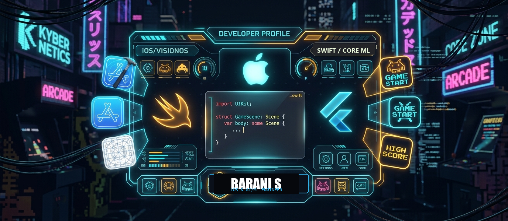
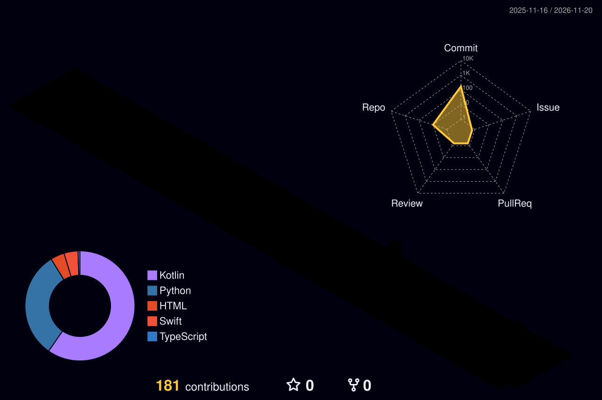

  <!-- Banner -->
  

  <!-- Hero accent glow -->
  

    

  <!-- Typing SVG -->
  

   

  <!-- Status Badges -->
  

    
    
    
    
  

  <!-- Social Links -->
  

    
    
    
    
  

  <!-- Profile Counters -->
  

    
    
    
  

<!-- Dev System Telemetry & Profile HUD Card (Dark/Light responsive: black in dark mode, white in light mode) -->

  <picture>
    <source media="(prefers-color-scheme: dark)" srcset="./assets/dev-system-dark.svg">
    <source media="(prefers-color-scheme: light)" srcset="./assets/dev-system-light.svg">
    
  </picture>

 

I build **native iOS applications** with Swift and SwiftUI — spanning the full app lifecycle from interface architecture and REST API integration to on-device AI/ML inference and App Store release management. My work focuses on healthcare intelligence, offline-first persistence, and high-performance mobile systems.

 

| Category | Skills | Technologies |
| :--- | :--- | :--- |
| **iOS Development** | Native App Development | <picture><source media="(prefers-color-scheme: dark)" srcset="https://skillicons.dev/icons?i=swift,apple&theme=dark"><source media="(prefers-color-scheme: light)" srcset="https://skillicons.dev/icons?i=swift,apple&theme=light"></picture> `SwiftUI` `UIKit` `Combine` `Core Data` `Swift Concurrency` |
| **On-Device AI / ML** | Machine Learning &amp; Computer Vision | <picture><source media="(prefers-color-scheme: dark)" srcset="https://skillicons.dev/icons?i=tensorflow,pytorch,py&theme=dark"><source media="(prefers-color-scheme: light)" srcset="https://skillicons.dev/icons?i=tensorflow,pytorch,py&theme=light"></picture> `Core ML` `TensorFlow Lite` `YOLOv8` `RAG Systems` |
| **Backend &amp; APIs** | Server-side &amp; API Integration | <picture><source media="(prefers-color-scheme: dark)" srcset="https://skillicons.dev/icons?i=nodejs,nestjs,php,mysql,redis,postman&theme=dark"><source media="(prefers-color-scheme: light)" srcset="https://skillicons.dev/icons?i=nodejs,nestjs,php,mysql,redis,postman&theme=light"></picture> `REST APIs` `JSON` `Judge0` |
| **Tools &amp; Platforms** | DevOps, Android &amp; Tooling | <picture><source media="(prefers-color-scheme: dark)" srcset="https://skillicons.dev/icons?i=kotlin,androidstudio,git,github,docker,linux&theme=dark"><source media="(prefers-color-scheme: light)" srcset="https://skillicons.dev/icons?i=kotlin,androidstudio,git,github,docker,linux&theme=light"></picture> `Xcode` `TestFlight` `Apple HIG` |

 

<!-- AI / ML Animated Progress Bar Matrix Card -->

  

 

<table border="0" width="100%">
  <tr>
    <td width="50%" align="center" valign="top">
      <a href="https://github.com/Barani2504/Corecare_iOS" target="_blank">
        <picture>
          <source media="(prefers-color-scheme: dark)" srcset="https://github-readme-stats.vercel.app/api/pin/?username=Barani2504&repo=Corecare_iOS&theme=tokyonight&show_owner=false&border_radius=10">
          <source media="(prefers-color-scheme: light)" srcset="https://github-readme-stats.vercel.app/api/pin/?username=Barani2504&repo=Corecare_iOS&theme=default&show_owner=false&border_radius=10">
          
        </picture>
      </a>
       
      <b>🩺 CoreCare iOS</b> — AI-powered cardiac care &amp; self-monitoring with offline-first persistence &amp; real-time chatbot.
    </td>
    <td width="50%" align="center" valign="top">
      <a href="https://github.com/Barani2504/Renal-Calculi" target="_blank">
        <picture>
          <source media="(prefers-color-scheme: dark)" srcset="https://github-readme-stats.vercel.app/api/pin/?username=Barani2504&repo=Renal-Calculi&theme=tokyonight&show_owner=false&border_radius=10">
          <source media="(prefers-color-scheme: light)" srcset="https://github-readme-stats.vercel.app/api/pin/?username=Barani2504&repo=Renal-Calculi&theme=default&show_owner=false&border_radius=10">
          
        </picture>
      </a>
       
      <b>🫘 SIMATS Renal Calculi</b> — On-device CT medical imaging &amp; kidney stone detection using Core ML &amp; YOLOv8.
    </td>
  </tr>
  <tr>
    <td width="50%" align="center" valign="top">
       
      <a href="https://github.com/Barani2504/Codego_Compiler" target="_blank">
        <picture>
          <source media="(prefers-color-scheme: dark)" srcset="https://github-readme-stats.vercel.app/api/pin/?username=Barani2504&repo=Codego_Compiler&theme=tokyonight&show_owner=false&border_radius=10">
          <source media="(prefers-color-scheme: light)" srcset="https://github-readme-stats.vercel.app/api/pin/?username=Barani2504&repo=Codego_Compiler&theme=default&show_owner=false&border_radius=10">
          
        </picture>
      </a>
       
      <b>⚙️ Codego Multi-Language Engine</b> — Load-balanced online code execution platform paired with RAG assistant.
    </td>
    <td width="50%" align="center" valign="top">
       
      <a href="https://github.com/Barani2504/Code_in_go_android" target="_blank">
        <picture>
          <source media="(prefers-color-scheme: dark)" srcset="https://github-readme-stats.vercel.app/api/pin/?username=Barani2504&repo=Code_in_go_android&theme=tokyonight&show_owner=false&border_radius=10">
          <source media="(prefers-color-scheme: light)" srcset="https://github-readme-stats.vercel.app/api/pin/?username=Barani2504&repo=Code_in_go_android&theme=default&show_owner=false&border_radius=10">
          
        </picture>
      </a>
       
      <b>📱 Code-In-Go Android</b> — Native mobile client engineered with Kotlin &amp; sandboxed telemetry execution.
    </td>
  </tr>
</table>

 

<b>🔍 View Architecture &amp; Engineering Details</b>

 

| Project | Tech Stack | Architecture &amp; Engineering Highlights |
|:--|:--|:--|
| **CoreCare iOS** | `SwiftUI`, `Core Data`, `SQLite`, `PHP`, `MySQL`, `REST APIs` | Offline-first encrypted local caching, continuous cardiac vitals tracking, and interactive AI chatbot for patient self-care. Multi-version TestFlight deployment. |
| **SIMATS Renal Calculi** | `SwiftUI`, `Core ML`, `TensorFlow Lite`, `YOLOv8` | 100% on-device neural network inference for radiology CT scans. Detects stone count, size, and anatomical coordinates without patient telemetry leaving device. |
| **Codego Platform** | `React`, `NestJS`, `Redis`, `Judge0`, `RAG` | Distributed load balancer orchestrating multi-language code executions across isolated sandboxes with Redis caching. |
| **LungCare** | `HTML5`, `CSS3`, `JavaScript`, `REST API` | Preventive respiratory telemetry portal with responsive interface and dynamic clinical metrics. |

 

**iOS App Developer Intern** · SIMATS Engineering  
`2025 — Present`

Full-lifecycle iOS development across a suite of production healthcare applications, from interface architecture through App Store releases, backend optimization, and cross-team mentorship.

- Developed and deployed **3–5 healthcare mobile apps** (Swift, SwiftUI) integrating REST APIs, JSON parsing, and on-device AI/ML inference following Apple HIG.
- Managed **App Store Connect &amp; TestFlight** release pipelines across multiple build cycles — versioning, provisioning profiles, and beta distribution.
- Optimized backend **PHP/MySQL query performance** and API response latency to improve reliability across client applications.
- Provided technical guidance and conducted code reviews for **100+ engineers** across iOS, Android, and web stacks (React, Flask, Node.js, PHP).
- Independently architected a load-balancing system and a **Judge0-based multi-language coding engine** powered by RAG.

`Swift` `SwiftUI` `Core ML` `PHP` `MySQL` `REST APIs` `Git` `Technical Mentorship`

 

  <table border="0">
    <tr>
      <td align="center">
        <picture>
          <source media="(prefers-color-scheme: dark)" srcset="https://github-readme-stats.vercel.app/api?username=Barani2504&show_icons=true&theme=tokyonight&hide_border=false&border_radius=10&count_private=true">
          <source media="(prefers-color-scheme: light)" srcset="https://github-readme-stats.vercel.app/api?username=Barani2504&show_icons=true&theme=default&hide_border=false&border_radius=10&count_private=true">
          
        </picture>
      </td>
      <td align="center">
        <picture>
          <source media="(prefers-color-scheme: dark)" srcset="https://github-readme-stats.vercel.app/api/top-langs?username=Barani2504&locale=en&layout=compact&theme=tokyonight&hide_border=false&border_radius=10">
          <source media="(prefers-color-scheme: light)" srcset="https://github-readme-stats.vercel.app/api/top-langs?username=Barani2504&locale=en&layout=compact&theme=default&hide_border=false&border_radius=10">
          
        </picture>
      </td>
    </tr>
  </table>

   

  <picture>
    <source media="(prefers-color-scheme: dark)" srcset="https://streak-stats.demolab.com?user=Barani2504&theme=tokyonight&hide_border=false&border_radius=10">
    <source media="(prefers-color-scheme: light)" srcset="https://streak-stats.demolab.com?user=Barani2504&theme=default&hide_border=false&border_radius=10">
    
  </picture>

 

<!-- Animated Achievements & Recognition HUD Telemetry Card -->

  

 

<picture>
  <source media="(prefers-color-scheme: dark)" srcset="https://raw.githubusercontent.com/Barani2504/Barani2504/main/profile-3d-contrib/profile-night-rainbow.svg">
  <source media="(prefers-color-scheme: light)" srcset="https://raw.githubusercontent.com/Barani2504/Barani2504/main/profile-3d-contrib/profile-green-animate.svg">
  
</picture>

Isometric 3D render of commit history — auto-updated daily via GitHub Actions.

 

  <picture>
    <source media="(prefers-color-scheme: dark)" srcset="https://raw.githubusercontent.com/Barani2504/Barani2504/output/pacman-contribution-graph-dark.svg">
    <source media="(prefers-color-scheme: light)" srcset="https://raw.githubusercontent.com/Barani2504/Barani2504/output/pacman-contribution-graph.svg">
    
  </picture>

 

 

  
  &nbsp;
  
  &nbsp;
  
  &nbsp;
  

 

<!-- Current Focus 2x2 Building Blocks Card -->

  

 

  If you find my work useful, consider giving a ⭐ to the repositories. Open to collaborations and opportunities.
   
  — <b>Barani S</b> · Native iOS &amp; AI/ML Engineer · Built with Swift &amp; Core ML

