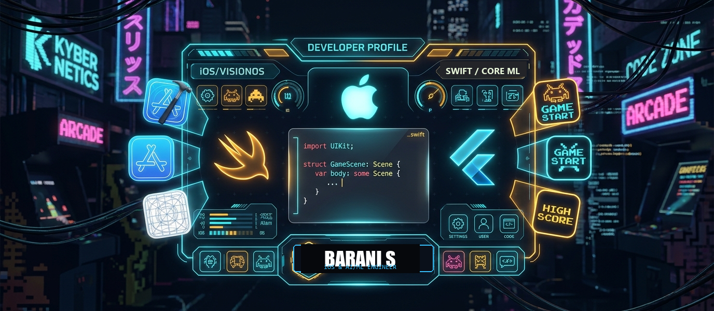

<div align="center">

  <!-- Banner -->
  <a href="https://linkedin.com/in/barani-s-4a479930b" target="_blank">
    
  </a>

  <br/><br/>

  <!-- Typing SVG -->
  <a href="https://git.io/typing-svg">
    
  </a>

  <br/>

  <!-- Status Badges -->
  <p align="center">
    
    
    
    
  </p>

  <!-- Social Links -->
  <p align="center">
    <a href="https://linkedin.com/in/barani-s-4a479930b" target="_blank">
      
    </a>
    <a href="mailto:barani2504s@gmail.com">
      
    </a>
    <a href="https://github.com/Barani2504" target="_blank">
      
    </a>
    <a href="#" target="_blank">
      
    </a>
  </p>

  <!-- Profile Counters -->
  <p align="center">
    
    
    
  </p>

</div>


### 👨‍💻 About Me

<div align="center">
  
</div>

<br/>

```swift
struct DeveloperProfile {
    let name: String         = "Barani S"
    let role: String         = "Native iOS & AI/ML Engineer"
    let education: String    = "B.Sc. Computer Science, 2022-2026"
    let organization: String = "SIMATS Engineering"

    // Core Expertise
    let primaryFocus: String = "iOS Healthcare & AI/ML Applications"
    let aiSpecialty: String  = "On-Device Inference - Core ML & TFLite"
    let deployment: String   = "App Store Connect & TestFlight"

    // Tech Stack
    let stack: [String] = [
        "Swift", "SwiftUI", "UIKit",
        "Core ML", "Combine", "TFLite"
    ]
}
```

- 🎯 **Focus:** Engineering production-grade iOS healthcare & AI applications with on-device intelligence.
- 🛠️ **Core Skills:** Swift, SwiftUI, UIKit, Core ML, TensorFlow Lite, YOLOv8, Combine, Core Data & Clean MVVM.
- 🏆 **Key Achievement:** Shipped 3–5 production medical apps to TestFlight & mentored 100+ developers.

I build **native iOS applications** with Swift and SwiftUI — spanning the full app lifecycle from interface design and REST API integration to on-device AI/ML inference and App Store release management. My work sits at the intersection of **mobile engineering, applied AI/ML, and full-stack backend development**, with hands-on delivery of healthcare and developer-tooling products used in real deployments.

I've shipped 3–5 production healthcare apps end-to-end, built a Judge0-based multi-language code execution platform backed by RAG, and mentored 100+ engineers across iOS, Android, and web stacks during code reviews.

<table align="center" width="100%">
<tr>
<td width="50%" valign="top">

**🔭 Currently**
- iOS App Developer Intern @ SIMATS Engineering
- Shipping AI-integrated healthcare apps to TestFlight / App Store
- Developing on-device neural vision pipelines with Core ML & YOLOv8

</td>
<td width="50%" valign="top">

**🌱 Open To**
- iOS Developer / Mobile Engineer opportunities
- AI/ML-integrated mobile products
- Full-stack & cross-platform mobile collaborations

</td>
</tr>
</table>

<br/>


### 🛠️ Technical Skills

<div align="center">

| Category | Skills | Technologies |
| :--- | :--- | :--- |
| **iOS Development** | Native App Development |  `SwiftUI` `UIKit` `Combine` `Core Data` `Swift Concurrency` |
| **On-Device AI / ML** | Machine Learning & Computer Vision |  `Core ML` `TensorFlow Lite` `YOLOv8` `RAG Systems` |
| **Backend & APIs** | Server-side & API Integration |  `REST APIs` `JSON` `Judge0` |
| **Tools & Platforms** | DevOps, Android & Tooling |  `Xcode` `TestFlight` `Apple HIG` |

</div>

<br/>


### 🧠 AI / ML Expertise

<div align="center">

| Domain | Proficiency | Details |
|:--|:--:|:--|
| **On-Device Inference** | ●●●●○ | Core ML & TensorFlow Lite deployment for offline, private, real-time predictions on iOS |
| **Computer Vision** | ●●●●○ | YOLOv8-based detection pipeline for medical CT image analysis (kidney stone detection) |
| **RAG Systems** | ●●●○○ | Retrieval-Augmented Generation for code assistant & multi-language platform support |
| **AI Chatbot Development** | ●●●●○ | Conversational health-monitoring chatbot with real-time vitals context |

</div>

<br/>


### 🚀 Featured Projects

<table border="0" width="100%">
  <tr>
    <td width="50%" align="center" valign="top">
      <a href="https://github.com/Barani2504/Corecare_iOS" target="_blank">
        
      </a>
      <br/>
      <sub><b>🩺 CoreCare iOS</b> — AI-powered cardiac care & self-monitoring with offline-first persistence & real-time chatbot.</sub>
    </td>
    <td width="50%" align="center" valign="top">
      <a href="https://github.com/Barani2504/Renal-Calculi" target="_blank">
        
      </a>
      <br/>
      <sub><b>🫘 SIMATS Renal Calculi</b> — On-device CT medical imaging & kidney stone detection using Core ML & YOLOv8.</sub>
    </td>
  </tr>
  <tr>
    <td width="50%" align="center" valign="top">
      <br/>
      <a href="https://github.com/Barani2504/Codego_Compiler" target="_blank">
        
      </a>
      <br/>
      <sub><b>⚙️ Codego Multi-Language Engine</b> — Load-balanced online code execution platform paired with RAG assistant.</sub>
    </td>
    <td width="50%" align="center" valign="top">
      <br/>
      <a href="https://github.com/Barani2504/Code_in_go_android" target="_blank">
        
      </a>
      <br/>
      <sub><b>📱 Code-In-Go Android</b> — Native mobile client engineered with Kotlin & sandboxed telemetry execution.</sub>
    </td>
  </tr>
</table>

<br/>

<details>
<summary><b>🔍 View Architecture & Engineering Details</b></summary>
<br/>

| Project | Tech Stack | Architecture & Engineering Highlights |
|:--|:--|:--|
| **CoreCare iOS** | `SwiftUI`, `Core Data`, `SQLite`, `PHP`, `MySQL`, `REST APIs` | Offline-first encrypted local caching, continuous cardiac vitals tracking, and interactive AI chatbot for patient self-care. Multi-version TestFlight deployment. |
| **SIMATS Renal Calculi** | `SwiftUI`, `Core ML`, `TensorFlow Lite`, `YOLOv8` | 100% on-device neural network inference for radiology CT scans. Detects stone count, size, and anatomical coordinates without patient telemetry leaving device. |
| **Codego Platform** | `React`, `NestJS`, `Redis`, `Judge0`, `RAG` | Distributed load balancer orchestrating multi-language code executions across isolated sandboxes with Redis caching. |
| **LungCare** | `HTML5`, `CSS3`, `JavaScript`, `REST API` | Preventive respiratory telemetry portal with responsive interface and dynamic clinical metrics. |

</details>

<br/>


### 💼 Work Experience

**iOS App Developer Intern** · SIMATS Engineering  
`2025 — Present`

Full-lifecycle iOS development across a suite of production healthcare applications, from interface architecture through App Store releases, backend optimization, and cross-team mentorship.

- Developed and deployed **3–5 healthcare mobile apps** (Swift, SwiftUI) integrating REST APIs, JSON parsing, and on-device AI/ML inference following Apple HIG.
- Managed **App Store Connect & TestFlight** release pipelines across multiple build cycles — versioning, provisioning profiles, and beta distribution.
- Optimized backend **PHP/MySQL query performance** and API response latency to improve reliability across client applications.
- Provided technical guidance and conducted code reviews for **100+ engineers** across iOS, Android, and web stacks (React, Flask, Node.js, PHP).
- Independently architected a load-balancing system and a **Judge0-based multi-language coding engine** powered by RAG.

`Swift` `SwiftUI` `Core ML` `PHP` `MySQL` `REST APIs` `Git` `Technical Mentorship`

<br/>


### 📊 GitHub Statistics

<div align="center">
  <table border="0">
    <tr>
      <td align="center">
        
      </td>
      <td align="center">
        
      </td>
    </tr>
  </table>

  <br />

  
</div>

<br/>


### 🏆 Achievements & Recognition

<div align="center">


<br/><br/>

| Achievement | Details |
|:--|:--|
| 🏥 **Healthcare App Delivery** | Shipped 3–5 production healthcare apps to TestFlight & App Store Connect |
| 👨‍🏫 **Peer Mentorship** | Guided and reviewed code for 100+ student developers across iOS, Android & web stacks |
| 🧠 **AI-Integrated Platforms** | Built on-device Core ML vision pipelines & RAG-powered developer platforms |

</div>

<br/>


### 📈 Contribution Activity

<div align="center">


<br/>

<table border="0">
  <tr>
    <td align="center">
      
    </td>
    <td align="center">
      
    </td>
    <td align="center">
      
    </td>
  </tr>
</table>

<sub>Contribution overview — commit history, language distribution & peak coding hours.</sub>

</div>

<br/>

### 🧊 3D Isometric Contribution Graph

<div align="center">


<sub>Isometric 3D render of commit history — auto-updated daily via GitHub Actions.</sub>

</div>

<br/>


### 🕹️ GitHub Contribution Snake

<div align="center">
  <picture>
    <source media="(prefers-color-scheme: dark)" srcset="https://raw.githubusercontent.com/Barani2504/Barani2504/output/pacman-contribution-graph-dark.svg">
    <source media="(prefers-color-scheme: light)" srcset="https://raw.githubusercontent.com/Barani2504/Barani2504/output/pacman-contribution-graph.svg">
    
  </picture>
</div>

<br/>


### 📜 Certifications & Coding Profiles

<div align="center">

<!-- Azure DP-900 Certificate Display -->
<p align="center">
  <a href="https://raw.githubusercontent.com/Barani2504/Barani2504/main/certificates/azure-dp900.pdf" target="_blank" title="Click to view or download high-resolution PDF">
    
  </a>
</p>

<sub>🔍 <i>Click the certificate image above to view or download the original high-resolution PDF</i></sub>

<br/><br/>

<!-- Metadata badges -->


<br/><br/>

<a href="https://raw.githubusercontent.com/Barani2504/Barani2504/main/certificates/azure-dp900.pdf" target="_blank">
  
</a>
&nbsp;
<a href="https://verify.certiport.com" target="_blank">
  
</a>

<br/><br/>
<sub><b>Key Competencies:</b> Cloud Concepts &nbsp;·&nbsp; Azure Relational &amp; Non-Relational Data &nbsp;·&nbsp; Modern Data Analytics &amp; Storage</sub>

<br/>


<br/><br/>

**Competitive Programming & Practice Platforms**

<br/>

  <a href="https://leetcode.com/u/Barani2504" target="_blank">
    
  </a>
  <a href="https://www.geeksforgeeks.org/user/barani2504" target="_blank">
    
  </a>
  <a href="https://www.hackerrank.com/barani2504s" target="_blank">
    
  </a>
  <a href="https://www.codechef.com/users/barani2504" target="_blank">
    
  </a>

</div>

<br/>


### 🎯 Current Focus

```yaml
learning:
  - Advanced Swift Concurrency & SwiftData
  - On-Device LLM & Vision Transformer Optimization
building:
  - Production AI-integrated healthcare & diagnostic iOS apps
  - RAG-powered developer compilation & mentorship tooling
exploring:
  - Cross-platform AI feature parity (iOS + Android)
  - Edge deployment of computer vision models (Core ML & YOLOv8)
open_to:
  - Native iOS Developer / Mobile Engineer roles
  - AI/ML-driven mobile engineering collaborations
```

<br/>


### 💬 Developer Quote

<div align="center">
  
</div>

<br/>

<div align="center">
  
  <br /><br />
  <sub>If you find my work useful, consider giving a ⭐ to the repositories. Open to collaborations and opportunities.</sub>
  <br/>
  <sub>— <b>Barani S</b> · Native iOS & AI/ML Engineer · Built with Swift & Core ML</sub>
</div>
